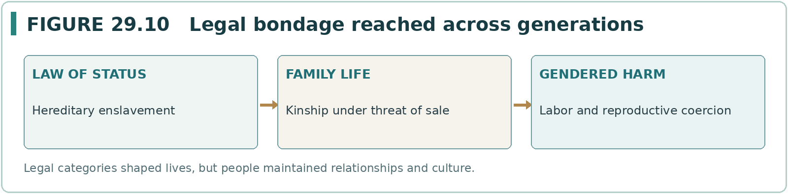

Поробените жени и мъже преживяват често отричане на свободата, но често се сблъскват с различни форми на трудова заетост и уязвимост. Жените могат да работят в области, пазари, кухни, работилници или домашни служби; те също са изправени пред сексуално насилие и репродуктивна принуда. Правните правила, създаващи поробен статут наследствен чрез майките, са неразделна част от растежа на населението в няколко колонии. Децата не са защитени от достъпа на институцията само защото са родени далеч от Атлантическите кораби.

Семействата се формираха и упорстваха въпреки условията, при които собственикът можеше да поръча преместване или продажба. Религиозната практика, именуването, разказването на истории, неформалното образование, отглеждането на храни и колективното полагане на грижи създадоха социални светове извън контрола на собственика. Устните традиции и по-късните спомени предлагат решаващи перспективи, въпреки че свидетелствата, записани след еманципацията, повдигат въпроси относно паметта, транскрипцията и влиянието на интервюиращите.

Съществуването на семейства и общност не омекоти робството в приемлива институция; то демонстрира човешко творчество под потисничество. Въпросът не е дали поробените хора са притежавали култура, което е очевидно, а как са изградили и защитили взаимоотношенията си вътре в структури, предназначени да ги направят уязвими.

<figure class="figure" id="figure-29-10">

<figcaption>Фигура 29.10. Правните категории оформят живота, но хората поддържат взаимоотношения и култура. <a class="figure-anchor" href="#figure-29-10" aria-label="Link to this figure">#</a></figcaption>
</figure>
