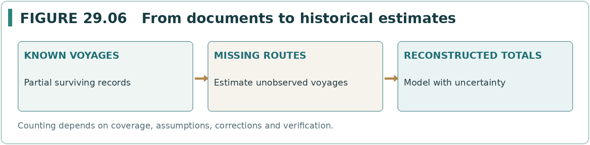

Историците използват пристанищни регистри, корабни записи, застрахователни документи, митнически сметки, известия на вестници и разпръснати кореспонденция за възстановяване на трафика през Атлантическия океан. Базата данни на SlaveVoyages позволява анализ на индивидуални известни пътешествия и моделирани оценки на общата стойност. Изследователите могат да изследват районите за качване, флаговете на корабите, пристанищата за разтоварване, периодите, разпределението на пол и възраст, където съществуват данни, както и последиците от липсващи наблюдения.

Да разгледаме един опростен пример, а не истински запис на пътуването. Да предположим, че пробата съдържа 20 документирани кораба, средно 280 души са се качили на борда, но архивните доказателства сочат, че 25 кораба са отплавали. Умножение 20 по 280 добиви 5,600 документирани качване. Оценка 25 × 280 предполага 7000. Петте ненаблюдаеми пътешествия правят съществена разлика; и ако липсващите кораби имат систематично различни размери, дори втората оценка може да бъде предубедена. Следователно историческата количественост е модел, информиран от доказателства, а не отгатване, облечен като прецизност.

Второ предупреждение се отнася до географията. Пътуването от африканско пристанище може да приключи в Бразилия, Карибите или Испания; по-късните продажби могат да изпратят същия човек на друга американска дестинация. Първото кацане не е задължително последното място на принудителния труд. Търговията с роби в Атлантика и търговията с роби в Америка са свързани, но аналитично различни.

<figure class="figure" id="figure-29-6">

<figcaption>Фигура 29.6. Преброяването зависи от обхвата, предположенията, корекциите и проверката. <a class="figure-anchor" href="#figure-29-6" aria-label="Link to this figure">#</a></figcaption>
</figure>
