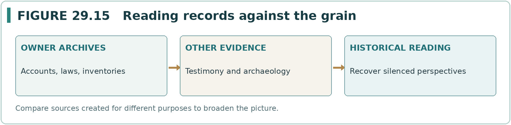

Основният ни проблем с източника прилича на дневника на пристанището от началната сцена. Рекордите, създадени от търговци на роби, администратори и саньори, могат да бъдат изключително прецизни относно цените, продажбите и корабоплаването, но все пак мълчат за личния опит. Историците четат тези материали "срещу зърното": те питат какво разкрива оплакването на собственика относно съпротивата, какво показва една реклама за беглец за семейните връзки или умения и защо съдебният регистър посочва човек само след конфликт.

Свидетелства на поробени преди хора, устни истории, археология на гробищата, материална култура, езикови проучвания и религиозни традиции осигуряват други пътища към историческото познание. Всеки източник има ограничения. Един аболиционистки памфлет може да използва драматични изображения, за да убеди; по-късен мемоар може да бъде оформен с време и публикуване; корабен манифест може да бъде непълен; археологически доказателства могат да идентифицират условията на живот без името на индивида. Сравнението води до по-силни заключения от третирането на един мощен източник като изчерпателен.

Особено важно разграничение се отнася до документи и снимки. Известната диаграма на британския робовладелски кораб Брукс или Брукс е била използвана от аболиционистите, за да разкрият тесни условия, но представлява конкретен визуален аргумент и конфигурация на кораба, а не всяко пътуване в Атлантическия океан. Историческите илюстрации следва да бъдат идентифицирани като източници с автори, дати и цели, а не представени като фотографски доказателства.

<figure class="figure" id="figure-29-15">

<figcaption>Фигура 29.15. Сравнете източниците, създадени за различни цели, за да се разшири картината. <a class="figure-anchor" href="#figure-29-15" aria-label="Link to this figure">#</a></figcaption>
</figure>
