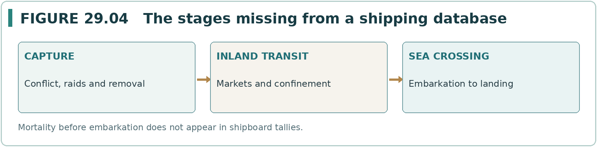

Средният проход започнал в морето, но много пленници страдали дълго преди един кораб да отплава. Хората можеха да маршируват във вериги, затворени на места за задържане, разделени от роднини и разменяни чрез множество търговски ръце. Крайбрежните укрепления като Елмина или Кейп Коуст Касъл станаха видими символи на търговията, въпреки че не всеки пленник премина през каменна крепост и крайбрежните истории значително се различаваха.

Смъртността е възникнала и по маршрутите от вътрешни общности до брега и в крайбрежното задържане. Тъй като тези смъртни случаи рядко са били регистрирани систематично, база данни за пътуване не може да измери цялата демографска загуба, причинена от търговията с роби. Също така не може лесно да се броят и допълнителните хора, изселени от страх, борба или разпадане на селското стопанство. Записът на хората, които са кацнали в американско пристанище, следователно е по-ниска граница за много по-широки форми на страдание, а не пълен човешки баланс.

За целите на преподаването представете си верига от доказателства: съдебни показания споменават за залавяне, сметка на търговец записва покупка във вътрешността на страната, доставка на форт счетоводна книга записи, кораб регистър прехвърляне на данни, и плантационна инвентаризация записи препродажба. Малко реални индивиди могат да бъдат проследени през всяка връзка. Реконструкцията на веригата изисква сравняване на записи, които са създадени за различни цели и често се използват непоследователни имена.

<figure class="figure" id="figure-29-4">

<figcaption>Фигура 29.4. Смъртността преди качването не се появява в корабните талони. <a class="figure-anchor" href="#figure-29-4" aria-label="Link to this figure">#</a></figcaption>
</figure>
