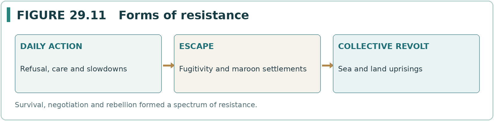

Съпротивата приема много форми: опити за бягство, забавяне на работата, саботаж, запазване на забранени практики, преговори, защита на роднините и преследване на независими религиозни или социални пространства. Тези действия се различават по отношение на риска, мащаба и намеренията. Не всеки акт на оцеляване е организиран бунт, но поробените хора многократно се опитвали да разширят тясната сфера на избор им позволявала.

Съпротивлението на борда се е случило въпреки сериозните ограничения. Похитителите могат да откажат храна, да се опитат да конфискуват кораби или да координират бунтове; записите на екипажа понякога документират тези борби, докато ги описват от гледна точка на робовладелците. На сушата бегълците формираха общности в горите, планините и граничните райони. Марунските общества оцеляха за различни периоди в Ямайка, Суринам, Бразилия и други области, преговаряйки, борейки се или търгувайки с околните държави.

Архивалната видимост на съпротивлението е неравна. Револтите създават драматични записи, но ежедневната съпротива може да се записва само като наказание или оплаквания. Ако напишем историята изключително чрез грандиозни бунтове, ще изтрием по-тихите, устойчиви борби за автономия; ако се съсредоточим само върху тихите форми, ще пропуснем политическото значение на колективния бунт.

<figure class="figure" id="figure-29-11">

<figcaption>Фигура 29.11. Оцеляването, преговорите и бунтът формираха спектър от съпротива. <a class="figure-anchor" href="#figure-29-11" aria-label="Link to this figure">#</a></figcaption>
</figure>
