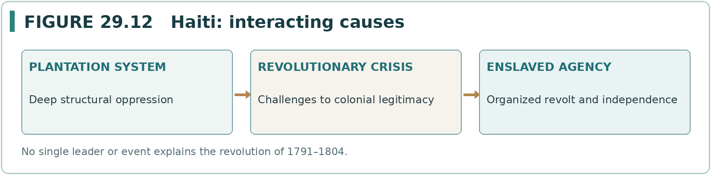

В навечерието на Френската революция френската колония Сен Доминг била една от най-богатите производители на захар и кафе в Атлантическия океан. Богатството му е изградено върху едно голямо поробено население, подложено на тежка експлоатация. Социалните дивизии включваха богати бели плантатори, по-бедни бели, свободни хора с цвят и поробени хора, но тези категории криеха още неравенства и изместващи се съюзи. Революционният език на свободата направи противоречието между универсалните права и колониалното робство невъзможно да се пренебрегне.

Въстанието на поробените хора започнало през 1791 г. на фона на по-широк конфликт. Военни и политически борби се развиват повече от десетилетие, включващи колониални фракции, френски власти, Испания, Великобритания и Черните командири. Тусант Лувертюр се появил като могъщ лидер, но не бива да бъде третиран като единствен архитект на революцията. Жан-Жак Десалин, други лидери, войници, работници и семейства също оформят борбата. Френското премахване през 1794 г. е последвано от опита на Наполеон да възстанови контрола; Хаити обявява независимост през 1804 г. след поражението на френската експедиция.

Хаитската революция показа, че поробените хора могат да свалят от власт плантационния режим и да създадат независима държава. Последствията му бяха международни: ужасяваше робите, вдъхновяваше антислейвърски движения и променяше имперската политика. Независимостта не заличи опустошението на войната, дипломатическата изолация или последващите искания за финансова компенсация. Постиженията на Хаити и последващите ограничения трябва да бъдат разбрани заедно.

<figure class="figure" id="figure-29-12">

<figcaption>Фигура 29.12. Нито един лидер или събитие не обяснява революцията на 1791 и 1804. <a class="figure-anchor" href="#figure-29-12" aria-label="Link to this figure">#</a></figcaption>
</figure>
