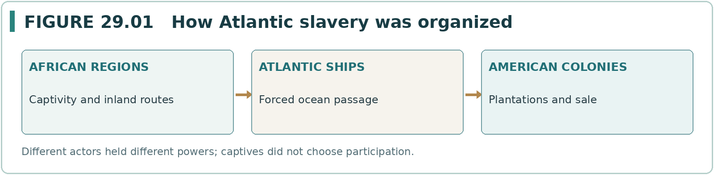

Робството съществувало в много региони много преди европейците да прекосят Атлантическия океан. В различни африкански, европейски, азиатски и американски общества се появиха капитулация, робство на дълга, принудителен труд и търговия с роби. Тези институции никога не са били идентични. Способността на човек да се ожени, да придобие собственост, да стане свободен, да предаде статут на деца или да бъде продаден различно с времето и мястото. Някои системи позволиха значително включване в семейства или политически структури; други бяха наследствени и брутално извлечени. Общият елемент е дълбоко отричане на свободата, но историците не могат да обяснят институциите, като казват просто, че робството винаги е съществувало.

Атлантиковата система все повече свързваше принудителната миграция към огромни експортно ориентирани плантации и към расови, наследствени правни категории. В много колонии поробените деца на жените наследили поробения статут и собствениците придобили законно защитени вземания над труда и телата. Законите, определящи кой може да бъде поробен, бяха създадени и закоравили чрез конфликти; расовата идеология помогна да се оправдае това, което икономическата и политическата власт направи възможно. Би било неточно да се предположи, че всяка по-ранна форма на робство е еквивалентна на робството на плантацията през 19 век.

Това разграничение има значение за отговорността. По - ранните форми на робство не направили Атлантик робството неизбежно, нито пък оправдават архитектите му. Европейски колонизатори, търговци, финансисти и законодатели изградиха и защитиха система за свързване. Африканските владетели и посредници понякога доставяли пленници или оспорвали търговията под различен натиск и стимули. Поробените хора не били нито пасивни, нито отговорни за наложената им принуда.

<figure class="figure" id="figure-29-1">

<figcaption>Фигура 29.1. Различни участници притежаваха различни правомощия; пленниците не избраха участие. <a class="figure-anchor" href="#figure-29-1" aria-label="Link to this figure">#</a></figcaption>
</figure>
