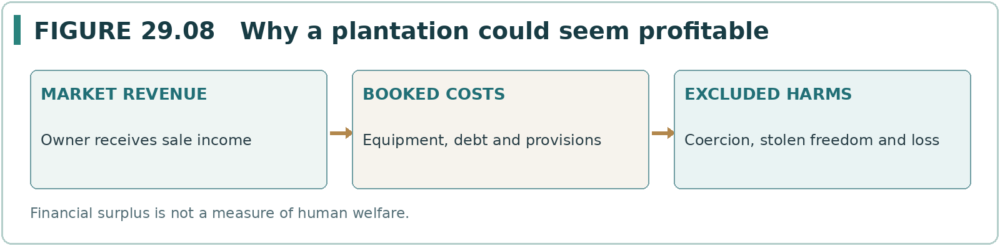

Отглеждането на захар се разшири в части от Бразилия и Карибите, защото климатът и достъпът до отвъдморските пазари направиха широкомащабното производство привлекателно за инвеститорите. Създаването на имот би могло да изисква значителен капитал за земя, мелници и оборудване, а операцията изискваше кредит, докато реколтата растеше. Следователно разработването на плантационни системи е свързано с банкови, дългови, корабни и дългосрочни търговски отношения, а не само с местни селскостопански решения.

Захарните плантации бяха жестоки работни места. Трудът в тропическа жега, изтощителните графици и заболяванията създават сериозни рискове за здравето. Някои плантационни общества внасяха постоянно пленници, вместо да разчитат на растежа на населението, отразявайки висока смъртност, неравномерно полово съотношение, лошо хранене и ограничения на принудителния труд. Но имаше различия между островите, десетилетията и имотите; един регионален модел не трябва да се превръща в универсално правило.

Икономическият урок е, че очевидната пазарна цена на дадена стока зависи от това какво се брои. Счетоводната книга на плантацията може да показва нетни приходи, след като плаща за кораби, машини и поробени хора, но не отразява откраднатата свобода или страданието на онези, които са принудени да работят. Една система с висока печалба може да бъде социално катастрофална, именно защото прехвърля разходи на хора, които отказват правна власт.

<figure class="figure" id="figure-29-8">

<figcaption>Фигура 29.8. Финансовият излишък не е мярка за хуманно отношение към хората. <a class="figure-anchor" href="#figure-29-8" aria-label="Link to this figure">#</a></figcaption>
</figure>
