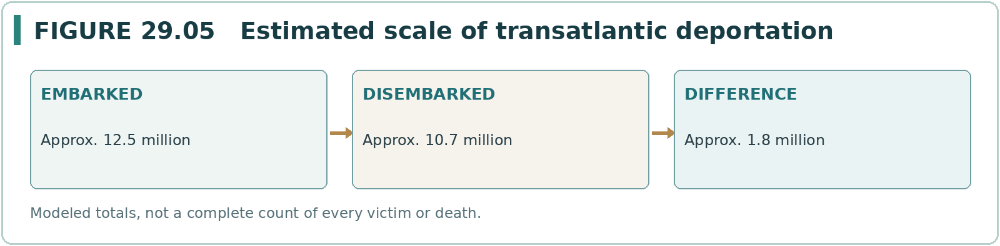

Принудителното прекосяване на Атлантическия океан било известно като Средния проход, защото образувало един етап от по-голям търговски маршрут. Похитителите са били транспортирани под палубите в тесни, нехигиенични условия, насилие и принуда. Болести, дехидратация, глад, нараняване и отчаяние са допринесли за смъртта. Условията се различават по кораб, десетилетие, продължителност на пътуването, осигуряване и устойчивост, но промените не намаляват вроденото насилие на системата. Оцелелите са изправени пред продажба и поробване при пристигане, а не на свобода в края на пътуването.

Проучванията, организирани чрез проекта SlaveVoyages, сочат, че приблизително 12,5 милиона поробени африканци са били на борда на трансатлантически кораби, като около 10.7 милиона слизат от кораба. Разликата е приблизително 1,8 милиона души, но тя не трябва да се тълкува като пълен брой смъртни случаи: категориите включват несигурност и цифрите не обхващат смъртност преди качването, нито всички по-късни загуби на живот. Данните съчетават документирани пътешествия с оценки за липсващи пътувания; това са исторически реконструкции, а не един перфектен списък на пътниците.

Когато една обща книга цитира процент на смърт, тя трябва да каже какво се измерва. Смъртните случаи между регистрираните качване и записваното слизане не са същите, както смъртните случаи от залавянето до плантацията, а средният процент в продължение на векове крие огромни различия. Хуманитарната трагедия не може да бъде сведена до статистика, но точните статистически данни помагат за коригирането на фантазиите за нейния мащаб.

<figure class="figure" id="figure-29-5">

<figcaption>Фигура 29.5. Моделирани числа, не е пълен брой на жертвите или смъртта. <a class="figure-anchor" href="#figure-29-5" aria-label="Link to this figure">#</a></figcaption>
</figure>
