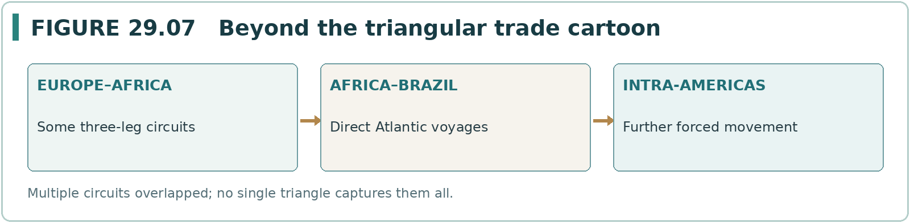

Много учебници илюстрират триъгълна търговия: европейските произведени стоки отиват в Африка, поробените африканци преминават към Америка и растителните стоки се местят в Европа. Някои вериги широко следват този модел и диаграмата помага да се обясни обменът между регионите. Но това не описва всяко пътуване. Корабите могат да плават директно между Бразилия и Ангола, да се движат между карибските острови, да се връщат с различни товари или да работят в рамките на регионалните мрежи. Американските търговци и инвеститори помогнаха за поддържането на търговията.

Опростеният триъгълник също може да скрие най-важната асиметрия. Дрехите, металните прибори, захарта и кафето бяха обменяни чрез търговски процеси; хората бяха заловени, продадени и насилствено транспортирани. Движението на принудителните хора не е етично или аналитично еквивалентно на движението на стоки между пазарите. Важно е да се определи кой е взел решения и на кого е била отказана възможността да откаже.

За по-богата картина представете си няколко припокриващи се мрежи: океански транспорт, застраховка и кредит, колониална политическа власт, вътрешни пътища, плантационна продукция и потребителско търсене. Парите и информацията се връщат в мрежата. Атлантическа икономика не е един чист маршрут, а система, в която много актьори вземат решения в различни мащаби.

<figure class="figure" id="figure-29-7">

<figcaption>Фигура 29.7. Множество вериги се припокриват; нито един триъгълник не улавя всички тях. <a class="figure-anchor" href="#figure-29-7" aria-label="Link to this figure">#</a></figcaption>
</figure>
