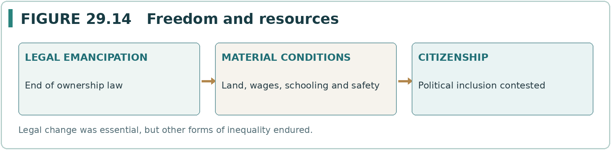

Формалното еманципиране сложи край на законното право на един човек да притежава друг, дълбока трансформация. То даде възможност за нови претенции към брака, семейната сигурност, движението, образованието, религията и политическото признаване. Бивши поробени хора построили църкви, асоциации за взаимна помощ, училища и общности; те договорили заплати и достъп до земя и преследвали собствените си видения за свобода. Въпреки това разпределението на собствеността рядко се трансформира толкова радикално, колкото би могло да се предположи в края на законната собственост.

Много бивши робовладелци запазиха земя, политическо влияние и кредит. Бившите поробени работници често са се сблъсквали с договори за експлоатация, споделяне, дискриминационни закони или насилие. В Съединените щати ерата на реконструкцията откри важни политически възможности, но след това беше лишена от франчайзинг, сегрегация и расов терор. В карибските и южноамериканските общества еманципацията също не гарантира равен достъп до образование, земя или политическо участие.

Този контраст помага да се разграничи правната свобода от практическата способност. Човек може да бъде законно свободен да напусне работодател, докато му липсват пари, земя, сигурно жилище или друга реалистична работа. Тези материални условия не изтриват революционното значение на еманципацията, но са необходими, за да обяснят нейните граници и дългата продължителност на борбите за равенство.

<figure class="figure" id="figure-29-14">

<figcaption>Фигура 29.14. Правната промяна е от съществено значение, но други форми на неравенство издържа. <a class="figure-anchor" href="#figure-29-14" aria-label="Link to this figure">#</a></figcaption>
</figure>
