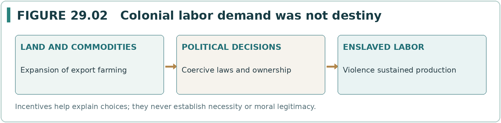

След 1492 г. европейското завоевание и селище създава търсене на труд в американските колонии. Захарни плантации, мини, тютюневи полета и по-късно кафе и памук имоти всички необходими работници при трудни условия. Колоницерите конфискуваха местни земи, наложиха принудителен труд на местните общности и реорганизираха местните икономики. Болести, войни, изместване и съпротива срещу принуда промениха трудовите режими, но тези промени не направиха африканското робство единствената възможна възможност. Колониалните власти, избрани сред трудовите системи в рамките на структури, които възнаграждават нискотарифния, контролиращия износ на труда и дългия транспорт.

Захарта дава силен пример. Нейната самоусъвършенстване и обработка изисква земя, оборудване, мелници, транспорт и взискателни трудови графици. Захарта е отглеждана другаде преди колонизацията в Атлантическия океан, включително средиземноморски и атлантически островни обекти, така че американските плантации са се възползвали от по-стари техники и практики. Но бързият растеж на колониалните плантации създаде търговско търсене на поробен труд в мащаб, невиждан досега в региона. Европейските потребители искаха сладки продукти; държавните служители искаха митнически приходи; търговците търсеха възвръщаемост; плантаторите искаха контрол над работниците. Резултатът не беше нито една конспирация, а поредица от решения, издържани от насилие.

До 17-ти и 18-ти век Атлантическият кораб свързва африканските залавяне региони, крайбрежни пазари, американски плантации, европейски индустрии и потребители. Да се опише това като пазар не означава доброволно участие на всички вътре в него. Хората бяха насилствено превърнати в стоки, докато много други участници преследваха печалби или политическо предимство.

<figure class="figure" id="figure-29-2">

<figcaption>Фигура 29.2. Стимулите помагат да се обяснят изборите; те никога не установяват необходимост или морална легитимност. <a class="figure-anchor" href="#figure-29-2" aria-label="Link to this figure">#</a></figcaption>
</figure>
