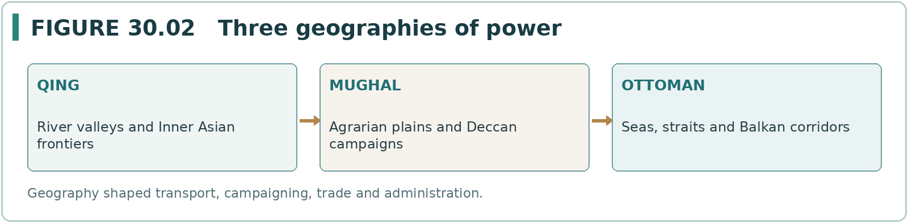

Цин е управлявал през земеделски равнини, речни долини, гори, пустини, оазиси и високи граници. Зърно и данъци в силно населени райони подкрепят имперската администрация и гарнизоните другаде. Реките и каналите свързваха производството с градовете, докато вътрешната азиатска дипломация и войната включваха коне, пасища, кервани и погранични укрепления. Империята била континентална, както и китайска, а нейните управници управлявали различни общности чрез различни институции.

Планините Мугал включваха индо-гангетическите равнини, Пенджаб, богати търговски градове и напоявани зони, с разширяване в Декан и други региони, изискващи трайни кампании и преговори. Икономиката му била дълбоко свързана с търговията в Индийския океан, но голяма част от императорската данъчна основа идвала от селското стопанство. Мусоните имат значение за морските търговци; мусоните, реките и циклите на прибиране на реколтата са еднакво важни за администраторите, събиращи приходи от земята.

Османците окупирали стратегически кръстопът: достъп до Черно море, Босфора, Егейското море, източните средиземноморски пристанища, Дунавските коридори, Анадолските маршрути, долината Нил, Сирия, Ирак и пътищата за поклонение към светите градове. Планинските вериги, островите и спорните граници правят централизирания контрол скъп. Имперската сила идва отчасти от поддържане на различни регионални системи, свързани без да настояват, че всеки район работи еднакво. Географското разнообразие е източник на ресурси и постоянен проблем с управлението.

<figure class="figure" id="figure-30-2">

<figcaption>Фигура 30.2. География форма транспорт, кампания, търговия и администрация. <a class="figure-anchor" href="#figure-30-2" aria-label="Link to this figure">#</a></figcaption>
</figure>
