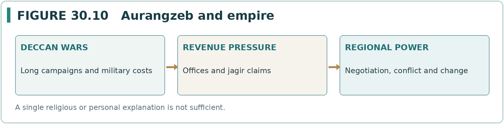

Aurangzeb (управлявани 1658 и т.н.7) дойде на власт чрез яростна борба за наследяване и председателстваше както широките имперски териториални обхвати, така и нарастващите щамове. Неговото царуване се обсъжда яростно, често защото по-късните националистически или обществени разкази намаляват сложните политики до една единствена преценка за религиозна толерантност или преследване. Доказателствата водят до политики, че някои общности в неравностойно положение, включително и повторното позициониране на Джизия през 1679 г., и епизоди на разрушение на храма, свързани с политически обстоятелства. Тя също така записва продължаване на службата от много индуски елити в императорските институции и разнообразни местни договорености.

Дълги войни в Декан срещу съпернически сили, включително Маратската съпротива, изискваха пари, войници и внимание. Разширяването на картата може да отслаби способността за ефективно управление. Военните победи не гарантираха, че новите територии ще предоставят надеждни приходи, а императорската система все повече се бореше с натиска около офисите, ягуарите и регионалните лидери.

Нито твърдението, че Aurangzeb лично "унищожи" напълно здрава империя, нито твърдението, че неговото управление е просто безпроблемен период на успех адекватно описва доказателствата. Структурните фискални и военни проблеми, регионалните идентичности, смяната на съюзите, борбата за наследяване и промяната на търговските отношения всички имаха значение. Полезният въпрос не е дали той е герой или злодей, а кои решения и условия правят трайното имперско управление все по-трудно.

<figure class="figure" id="figure-30-10">

<figcaption>Фигура 30.10. Едно религиозно или лично обяснение не е достатъчно. <a class="figure-anchor" href="#figure-30-10" aria-label="Link to this figure">#</a></figcaption>
</figure>
