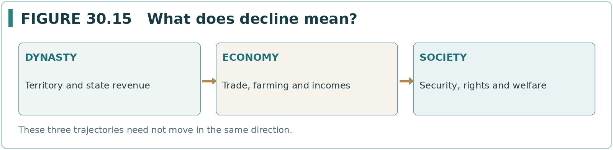

Компактното сравнение разкрива модели, като запазва различията. Управителите на Цин комбинираха гражданската бюрокрация и изпити с банермени, гранични институции и множество режими на легитимност. Мугалс организираха военни елити чрез чинове и ягорски назначения, подкрепени от аграрно данъчно облагане и съюзи с регионални притежатели на власт. Отоманите са използвали дворцова администрация, правни и религиозни институции, тимарски и саламандри, провинциални споразумения и разширяващи се данъчни ферми. Всички разчитаха на посредниците, но разпределяха ресурси и вербуваха елити по различни начини.

Религиозните политики също се противопоставиха на простото класиране. Цин императорите работили в рамките на китайските ритуални традиции и подкрепяли тибетския будизъм в определени условия; религиозният и културен контрол варирал. Съдът на Акбар в Мугал изразил обширно настаняване, докато Ауранджеб преследвал различна смесица от ангажименти, ограничения и политически договорености. Османските владетели поддържали ислямските институции, докато управлявали значителни немюсюлмански общности чрез диференцирани правни отношения. Сравняването на думи като "толерантност" изисква да се търсят извън официалните изявления практически права, данъчно облагане и модели на насилие.

Никоя империя не е била изключително земеделска или чисто търговска. Търговията с Цин, моголските текстилни изделия и османските транзитни маршрути донесоха приходи и влияние, но всеки от тях се основаваше на сложна аграрна основа. Най-силното сравнение не е кой е бил най-напреднал, а кои институции са отговаряли на подобни проблеми, какви разходи са налагали и колко добре са се адаптирали с промените в условията.

<figure class="figure" id="figure-30-15">

<figcaption>Фигура 30.15. Тези три траектории не трябва да се движат в една и съща посока. <a class="figure-anchor" href="#figure-30-15" aria-label="Link to this figure">#</a></figcaption>
</figure>
