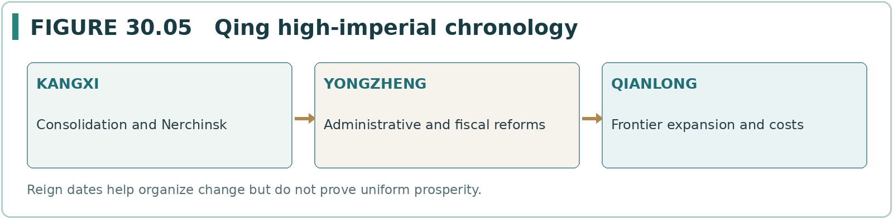

Три дълги или последвали царувания оформиха високия имперски период на Цин: Кангси (подчинен 1661 и 1772 г.), Йовженг (1722 и 1735 г.) и Кианлонг (1735 и 1796). Правителството на Кангси преодоля бунта на трите феудатории, консолидира Тайван след поражението на режима на Женг през 1683 г. и оспорва властта в цяла Вътрешна Азия. Войната с Русия приключи в Договора от Нерчинск през 1689 г., едно от няколкото дипломатически споразумения, чрез които границите и търговията бяха договорени.

Йонгженг следва административни и фискални мерки, включително реформи в събирането и разпределянето на данъци и вниманието към работата на императорските комуникации. Qianlong председателства териториалната експанзия, по-специално кампаниите от средата на осемнадесети век срещу Dzungar полити и в Xinjiang. Тези войни включваха масово насилие, насилствено изместване и реорганизация на пограничните общества; думата "разширяване" не трябва да крие цивилни последствия.

Правилото от 18-ти век също създава впечатляващи литературни компилации, художествено покровителство и монументална сграда. И все пак идеалът на съда за благоденствие бил неравномерно споделян. Растежът на населението, натискът върху земята, местната корупция, стреса в околната среда и пограничните ангажименти предизвикаха предизвикателства. По-късните кризи на Цин от деветнадесети век принадлежат главно към следващите глави, но корените им не трябва да бъдат изтривани от една безкритична история за златната епоха.

<figure class="figure" id="figure-30-5">

<figcaption>Фигура 30.5. Царуване дати помагат за организиране на промяна, но не доказват еднакво просперитет. <a class="figure-anchor" href="#figure-30-5" aria-label="Link to this figure">#</a></figcaption>
</figure>
