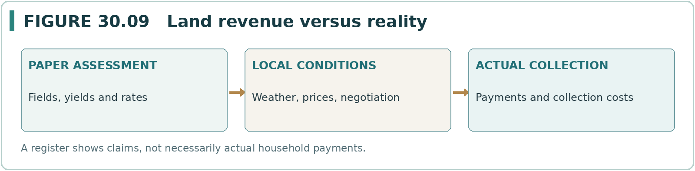

Повечето имперски ресурси в крайна сметка идват от селскостопанско производство. Държавата трябвало да знае каква земя можела да добива, как се разнообразявали жътвите и кои общности щели да плащат. Според Akbar фискалните служители, свързани с Раджа Тодар Мал, са разработили мерки и договорености, често описани чрез системите за приходи на Zabt или Dahsala в части от северна Индия. Технологията включваше измерване, оценка, класификация и оценка, но нямаше единен механизъм за приходите, използван еднакво във всяка област.

Земеделското домакинство има опит в политиката по отношение на приходите като задължение, изразено в зърно, пари, труд или преговори, в зависимост от местоположението и обстоятелствата. Колекционерите биха могли да се сблъскат с неуспех на реколтата; селяните можеха да се изправят пред изисквания, които не успяха да се адаптират адекватно към местните трудности. Заминдарите може да посредничат плащания, да поддържат въоръжени следи или да претендират за собствените си права. Оценката на императорската хартия не беше същата като действително събраните приходи след времето, укриването, конфликтите и административните разходи.

Мугалската икономика не била просто механизъм за извличане на зърно. Самоусъвършенстващите се произвеждат храни и търговски култури, занаятчии произведени текстил, търговци преместват стоки и кредити, а градовете поддържат плътни пазари. Въпреки това, най-големите почести в съда в крайна сметка почиват на излишъка от селското стопанство. Сравняването на напояването, оценката и движението на зърното ни учи повече за ежедневния императорски капацитет, отколкото само за списък с битки.

<figure class="figure" id="figure-30-9">

<figcaption>Фигура 30.9. Регистърът показва вземания, а не непременно реални плащания за домакинствата. <a class="figure-anchor" href="#figure-30-9" aria-label="Link to this figure">#</a></figcaption>
</figure>
