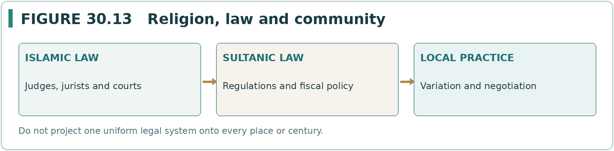

Османското управление съчетава ислямската съдебна практика, правни учени и съдилища със султански регулации, често наричани канун. Съдиите, или кадис, се занимавали с спорове и регистрирани сделки, докато религиозните власти тълкували закона. Не всички са имали еднакви правила. Полът, правния статут, населеното място и принадлежността към общността засегнаха правата и практическите резултати. Съдебните регистри могат да запазят подробности за обикновените спорове относно брака, дълговете, наследството и имуществото, въпреки че достъпът до правосъдие е неравнопоставен.

Мюсюлманските и немюсюлманските поданици живеели в цялата империя. Православни християни, арменски християни, евреи и други групи поддържали институции, преговаряли с властите и плащали данъци, чиято форма и честота се променяла с времето и мястото. Терминът просо често се използва за описване на обществената организация, но подредената картина на фиксирана, напълно развита "милетна система," работеща навсякъде от 1453 г., е анахронистична. По-късните формални категории не следва да се проектират автоматично към шестнадесети век.

Религиозното настаняване съществуваше съвместно с йерархията и дискриминацията. Някои малцинствени общности биха могли да управляват аспекти на обществения живот и да поддържат търговски мрежи; те не притежаваха модерно равно гражданство. Възникнаха и конфликти, принудителни промени, ограничения и местно насилие. Въпросът дали империята е "толерантна" дава само частичен отговор. Попитайте вместо това: в сравнение с какво, в кой период, за кого и по какъв закон?

<figure class="figure" id="figure-30-13">

<figcaption>Фигура 30.13. Не проектирай една единна правна система на всяко място или век. <a class="figure-anchor" href="#figure-30-13" aria-label="Link to this figure">#</a></figcaption>
</figure>
