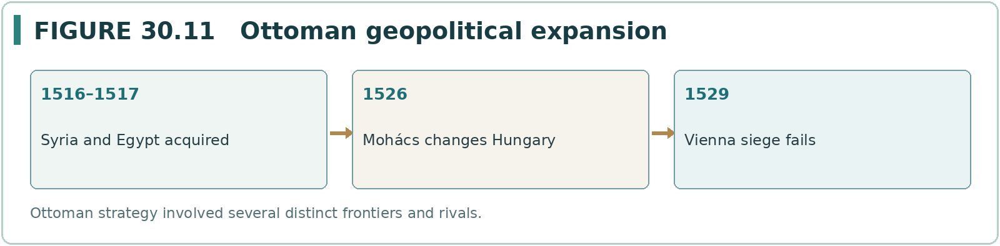

В началото на шестнадесети век османската династия управлявала поколения наред. Завоюването на Константинопол през 1453 г. направи Истанбул императорски център. Кампаниите на Селим I през 1516 и 1517 г. побеждават султана Мамелук и подвеждат Сирия и Египет под отомански контрол, като последиците за източното Средиземноморие, Червено море и ислямски свещени градове са изключително важни. Контролът варираше по региони, но тази трансформация даде на османските владетели нови източници на легитимност, приходи и стратегическа отговорност.

Сюлейман I (прибяга 1520.566), известен в различни традиции като "Великолепния" или "Законодателят," разширява османското си присъствие. Битката при Мохац през 1526 г. разби средновековното унгарско царство и преобрази Данубската политика. Османските сили обсадиха Виена през 1529 г., без да я заловят; конфликтите с хабсбургските владетели продължиха. В Ирак и Източна Анадола съперничеството със Сафавид Иран оформи военната и изповедническа политика. Разширяването включва и военноморска война и дипломация в Средиземно море.

Тези кампании не оставили една равномерно управлявана империя. Някои територии били управлявани пряко; други плащали данък, запазвали династии или договорени форми на зависимост. Османските победи трябва да бъдат разположени в европейските, иранските, арабските и северноафриканските политически светове, а не представени като изолирани действия на един владетел.

<figure class="figure" id="figure-30-11">

<figcaption>Фигура 30.11. Османската стратегия включва няколко различни граници и съперници. <a class="figure-anchor" href="#figure-30-11" aria-label="Link to this figure">#</a></figcaption>
</figure>
