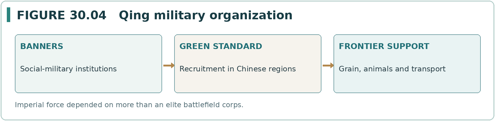

Манхус се появява от североизточната граница под ръководството на Нурхачи и неговите наследници. Институции, по-късно известни като осемте Банери организираха хора във военни и социални общности със задължения и привилегии; те не бяха само осем групи от бойни знамена. Членството в Банер включваше Манхъс, монголци и китайци Хан и беше променено от завоевание. Банеровата система помогнала за поддържането на династичната идентичност дори когато владетелите на Цин приели много форми на китайско правителство.

Хонг Тайджи формализирал името Цин династично през 1636 г. През 1644 г., Доргон и свързаните с него сили влезли в Пекин на фона на кризата с Минг, поставяйки младия император Шунджи в центъра на нов имперски ред. След това Цин разшири и се бори регионални ищеци, включително южен Ming лоялните лица. Нейните военни също така наемат Зелената стандартна армия, много от чиито войници са били наети от бившите войски на Минг и китайските общности. Империята от този мащаб не може да бъде държана само от банерните сили.

Завоеванието включвало унищожение, реквизиция и политики като реда на опашката, която се превърнала в видим символ на подчинение и причина за съпротива. Ретроспективно изображение на хармоничен "династичен преход" може да замъгли изгубените животи и трудните десетилетия на консолидация. Новите владетели изграждат легитимност чрез ритуал и администрация, но принуда е от основно значение за основополагащия процес.

<figure class="figure" id="figure-30-4">

<figcaption>Фигура 30.4. Имперската сила зависела от повече от елитен боен корпус. <a class="figure-anchor" href="#figure-30-4" aria-label="Link to this figure">#</a></figcaption>
</figure>
