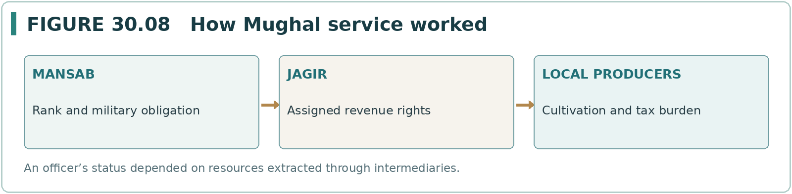

Системата Mughal mansabdari определя редиците на имперските офицери, изразени чрез номера, свързани с личния статут и военните задължения. Термините като Зат и Сафар станаха важни при определянето на позицията, а кавалерията очаквана от офицер. Системата не е била напълно последователна формула през цялата си история и съотношението между номиналните редици и силите, присъстващи в кампанията, може да се различава. Въпреки това той осигурил език, който съдът да организира своите служители.

Много притежатели били компенсирани чрез възлагане на поземлени приходи, често наричани Джагир, а не чрез постоянна частна собственост върху земя. Обикновено Джагирдар получавал права да събира определени приходи от дадена област в подкрепа на своята позиция и услуга. Такива задачи могат да бъдат прехвърлени. Местните собственици, селските общности и zamindars... чиито роли се различават по региони, които не могат да притежават претенции и влияние. Империята разчитала на посредници, а не пряка линия от императора до всеки самоусъвършенстващ се.

Споразумението създаде гъвкавост и опасност. Императорът може да премести офицерите и да предотврати постоянни концентрации на власт. Но офицерите, които се състезават за адекватни задачи, могат да натиснат силно върху общностите, плащащи приходи, докато далечните длъжностни лица може да изкривят ресурсите. Ако твърде много редици са били възложени във връзка с събиране на доходи, конфликтът се засили. Не си представяйте статична феодална система: Мугал класация, парични плащания, права на доходите на земята и местната политика се промениха заедно с течение на времето.

<figure class="figure" id="figure-30-8">

<figcaption>Фигура 30.8. Офисът зависи от ресурсите, извлечени чрез посредниците. <a class="figure-anchor" href="#figure-30-8" aria-label="Link to this figure">#</a></figcaption>
</figure>
