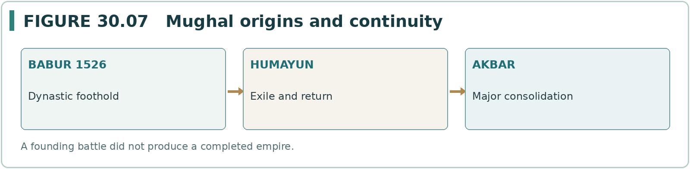

Династията Мугал е възникнала от един централноазиатски свят на принцовете, оформен от Тимурид и Чинггизид. Бабур, владетел на Тимурид, победил Ибрахим Лоди в Първата битка при Панипат през 1526 г. и установил нова династична опора в Северна Индия. Победата не означаваше мигновен контрол над целия субконтинент. Бабур се изправи срещу опозицията и неговите наследници трябваше да консолидират несигурни териториални и политически претенции.

Humayun губи властта на афганистанската сръбска династия, свързана с Sher Shah Suri, и прекарва известно време в изгнание, включително в съда на Сафавид в Иран. Той възстановява Delhi през 1555, но почина на следващата година. Интерлюдието е полезно, защото ни напомня, че победителят основател не изгражда автоматично трайно състояние. Администрацията, валутата и пътната политика на Шер Шах също имат трайно значение и оказват влияние върху по-късната практика.

Терминът "Mughal," получен чрез персийската употреба от Монгол, не би трябвало да ни накара да си представим една монголска армия от тринадесети век трансплантирана в Индия. Управляващата култура на династията била персийски, военните и аристокрацията му се променяли с течение на времето, а легитимността ѝ се развивала чрез брак, съюз, съдебни ритуали и административни успехи. Империята била индийска в ежедневните си социални основи, дори когато управляващата къща си спомняла за предците си от Централна Азия.

<figure class="figure" id="figure-30-7">

<figcaption>Фигура 30.7. Една основателна битка не създала завършена империя. <a class="figure-anchor" href="#figure-30-7" aria-label="Link to this figure">#</a></figcaption>
</figure>
