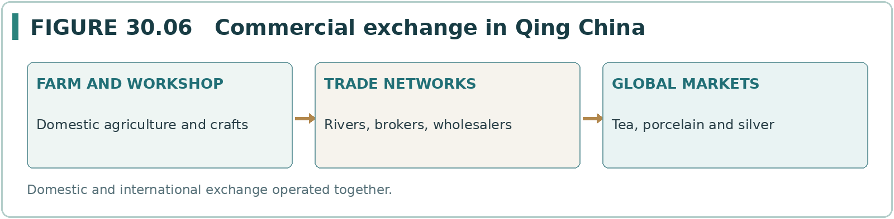

Селското стопанство подкрепяше повечето домакинства. Отглеждането на ориз, пшеницата и други зърна, регионалните парични култури и сложните транспортни и напоителни системи произвеждат стоки за местните и по-широки пазари. Търговските мрежи свързват високопроизводителни региони като по-ниския Янци с градове в цялата империя. Растежът на населението и променящите се модели на селище промениха търсенето на земя, гориво, вода и труд. Разширяването на пазарите не трябва да се бърка с еднакъв просперитет за всички производители.

Китайска коприна, чай и порцелан се разпространиха широко. Порцеланът е направен в рамките на сложни системи от труд, специализация, правителствени поръчки и частна търговия. Европейското търсене имаше значение, но азиатските потребители и вътрешните пазари бяха значителни; Китай не съществуваше само за да осигури европейски рафтове. Движението на сребро отразява множество мрежи и стимули, включително износ и данъчни плащания. Не е правилно да се твърди, че една пратка американски сребро просто "финансира" цялата империя.

Търговската система на Кантон ограничавала каналите, чрез които много западни търговци оперирали през по-късно осемнадесети век. Чуждестранното участие беше регулирано, вместо изцяло да липсва. Китайските търговци, търговските фирми и длъжностни лица притежаваха правомощия за договаряне. Но това споразумение по - късно щяло да се превърне във флаш-пойнт, тъй като британските и други имперски интереси търсели различни термини. Тези конфликти от 19 век не трябва да се четат назад като доказателство за слабостта на Цин през 1700 г.

<figure class="figure" id="figure-30-6">

<figcaption>Фигура 30.6. Вътрешният и международният обмен се осъществяват заедно. <a class="figure-anchor" href="#figure-30-6" aria-label="Link to this figure">#</a></figcaption>
</figure>
