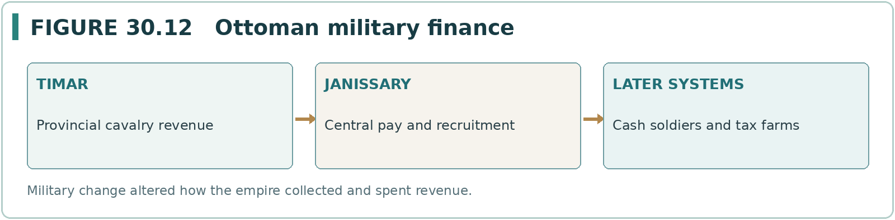

Османската военна организация се промени значително с течение на времето. Системата Тимар предоставяла права върху приходите от определени земи на кавалеристи, известни като sipahis, в замяна на службата; тя не просто им давала абсолютна частна собственост над всички селяни и ниви. Държавните проучвания и данъчните регистри, тахририте, помогнаха да се уточнят претенциите в някои провинции. Други региони използваха различни фискални и военни договорености.

Дженичарите са се развили като елитна пехота, свързана с домакинството на султана и платена от централната хазна. Набиране исторически включва devshirme, таксата на момчета от някои християнски общности, които са били превърнати в исляма и обучени за имперска служба. Процесът беше принудителен дори когато той създаваше пътища за работа на някои хора. С течение на времето набирането на персонал, членството, привилегиите и политическото влияние се промениха значително; корпусът не трябва да бъде третиран като вечен, непроменящ се инструмент.

Обсадна артилерия и огнестрелни оръжия са допринесли за османските победи, но нито са направили укрепление, финанси или дипломация остарели. През 17 - и век империята използвала допълнително заселени войници и военни трудови пазари, когато войната се променила. Растежът на паричните разходи насърчи фискалната адаптация. Затова силната военна система е връзка между технологиите, хората, приходите и политическата власт, а не опис на оръдията.

<figure class="figure" id="figure-30-12">

<figcaption>Фигура 30.12. Военната промяна променила начина, по който империята събирала и харчела приходи. <a class="figure-anchor" href="#figure-30-12" aria-label="Link to this figure">#</a></figcaption>
</figure>
