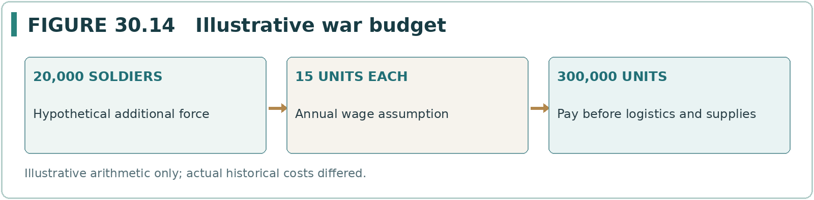

Всяка империя се изправяла срещу въоръжени съперници. Граничната кампания Цин изискваше животни, зърно, пари и транспорт на необикновени разстояния. Мугалските кампании в Декан завързват силите и влошават натиска върху приходите. Османците водят скъпи войни срещу Хабсбург, Сафавид, Русия и други опоненти, докато управляват военноморските ангажименти. Армията може да спечели битка, но ще остави хазната незащитена или провинция изтощена.

Представете си хипотетично административно изчисление: владетел вербува още 20 000 войници със средна годишна парична цена от 15 парични единици всяка. Само заплатите са 300 000 единици, преди оборудването, храната, транспорта и гарнизонното строителство. Това е изчисление на учението, не реконструкция на нито една армия. Ако дадена провинция получи 500 000 единици данъчни приходи, излишъкът от хартия може да се изпари след събиране на разходите, местни задължения и неуспешна реколта. Военният достъп зависи от фискалния капацитет, а фискалният добив може да навреди на производството, от което се основава този капацитет.

Основният механизъм е обратна връзка. Войната води до по-високи разходи; повишаването на приходите може да предизвика съпротива или трудности; вълненията изискват допълнителни военни разходи. Ефективните реформи могат да прекъснат цикъла, докато лошата информация или слабите институции могат да го задълбочат. Този модел не може да замени конкретните факти на всяка империя, но дава въпрос на читателите да се зададат на всеки разказ за кампанията: кой е доставил храната, конете, заплатите и кредита?

<figure class="figure" id="figure-30-14">

<figcaption>Фигура 30.14. Само илюстративна аритметика; действителните исторически разходи се различават. <a class="figure-anchor" href="#figure-30-14" aria-label="Link to this figure">#</a></figcaption>
</figure>
