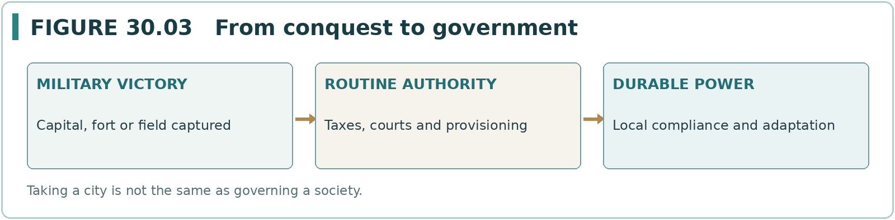

Завоеванието може да прехвърли дворец, армия или данъчна служба в нова династия. Дълготрайно правило изисква убеждаване или принуждаване на други хора да извършват рутинна работа: оценка на полета, измерване на зърното, уреждане на съдебни дела, поддържане на пътища, доставка на коне, регистър домакинства и управление на местни спорове. Всяка империя наследила утвърдени институции и ги преустроила. Цин е запазил много граждански институции в Минг заедно с отделна военна-политическа институция Манчу. Мугалите включили персийски административни традиции и регионални индийски практики. Османците съчетават династичната власт с ислямската съдебна практика, султанското законодателство и местните договорености.

Затова работата на една империя била колективна и често спорна. Провинциален управител може да попречи на политиката; търговците могат да преместят капитал; войниците могат да се разбунтуват; селяните могат да избягат от потисническите данъчни искания. Имперската политика се появява в прокламации, но историците оценяват изпълнението чрез счетоводни книги, съдебни дела, петиции, кореспонденция, архитектура и местни доказателства. Официалната диаграма на една държава често крие договарянето, което я е накарало да функционира.

Властта също може да донесе защита, нови пазари, патронаж и инфраструктура, като същевременно налага война, неравноправна привилегия и принуда. Обяснение на административния успех никога не трябва да се бърка с одобрение за одеяло. Добрата история пита кой е изпитал стабилност, кой е платил разходите си и кога балансът се е променил.

<figure class="figure" id="figure-30-3">

<figcaption>Фигура 30.3. Да превземеш град не е същото като да управляваш общество. <a class="figure-anchor" href="#figure-30-3" aria-label="Link to this figure">#</a></figcaption>
</figure>
