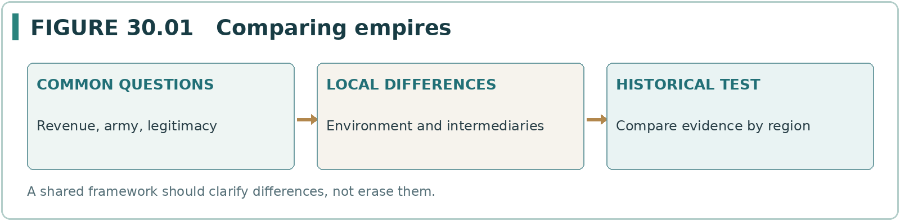

Сравнението може да разкрие скрити структури от отделни разкази. Задавайте едни и същи въпроси на всяка империя. Откъде идват приходите? Кой управлява селата? Кои армии са платени в брой, приходи от земя или наследствени надбавки? Как управниците се представяли на хора от различни религии и езици? Какво стана, когато местните елити спряха сътрудничеството? Кои региони останали извън строг императорски контрол? Тези общи въпроси позволяват обяснения, по-силни от парад с имена на императора.

Но трите територии не са еквивалентни кутии на картата. Цин суверен над монголските степни общности не функционира като рутинна гражданска администрация в долината Янгзи. Мугал твърди, че районът може да оцелее дори докато регионалният принц контролира ресурсите си. Османците имали различни договорености за ядрото на Анадола, арабските провинции, автономните притоци и граничните зони. Картата с цветни атласове предлага отправна точка, а не административен одит.

По-старата стипендия понякога групирала Мугалите, османците и Сафавид като империи на барута. Огнестрелните оръжия и обсадната артилерия са от значение, а династията Сафавид в Иран остава незаменима за историята. Но етикетът може да направи технологичното предимство да изглежда като основната причина за властта. Приходите, кавалерията, напояването, съюзите, семейната политика, религията, търговията и способността да се адаптират институциите са също толкова важни. Цин е възникнал по-късно и не трябва просто да бъде изстискан в същата технологична категория. Използвайте етикети като инструменти, а не обяснения в себе си.

<figure class="figure" id="figure-30-1">

<figcaption>Фигура 30.1. Споделената рамка следва да изяснява различията, а не да ги заличава. <a class="figure-anchor" href="#figure-30-1" aria-label="Link to this figure">#</a></figcaption>
</figure>
