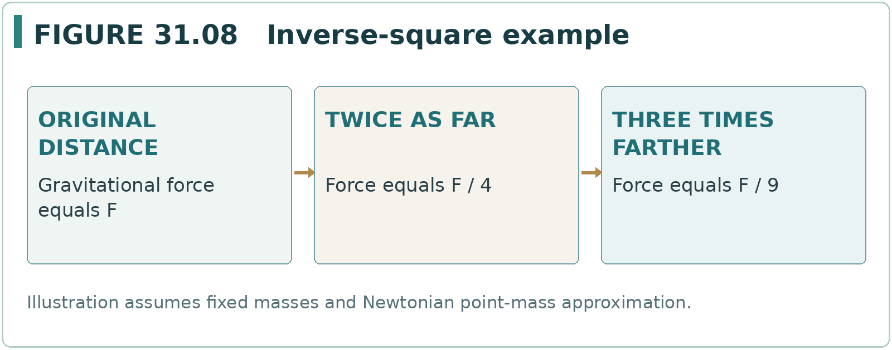

Да разгледаме един измислен пример за орбитален обект, чието разстояние от централна маса се удвоява, докато други условия за опростяване държат. Обратната квадратна връзка на Нютон предполага, че гравитационната сила на по-голямо разстояние е една четвърт от първоначалната сила. Разширяването на разстоянието ще го намали до една девета. Изчисляването е просто, но неговото заключение е съществено: компактно правило се прилага за огромен диапазон от възможни случаи.

Това, което правилото не ви казва само по себе си е цялата орбита на обекта. Имате нужда и от първоначалната му скорост, маси и влиянието на други тела. Обектът може да бъде привлечен силно към планетата и все още пропуска повърхността си, ако има достатъчно странично движение. Истинското орбитално обяснение съчетава сила с движение, вместо да си представя планети някак си балансирани срещу привличане.

Тук има важен епистемичен навик. Използвайте математика, за да направи твърдение по-точен, но не позволявайте на елегантна формула крие своите предположения. Обратното-квадрат изявление работи за Newtonian гравитация в съответните приближения. Числото е информативно, когато можем да обясним откъде идва и на кои въпроси всъщност отговаря.

<figure class="figure" id="figure-31-8">

<figcaption>Фигура 31.8. Илюстрация предполага фиксирани маси и newtonian точка-маса сближаване. <a class="figure-anchor" href="#figure-31-8" aria-label="Link to this figure">#</a></figcaption>
</figure>
