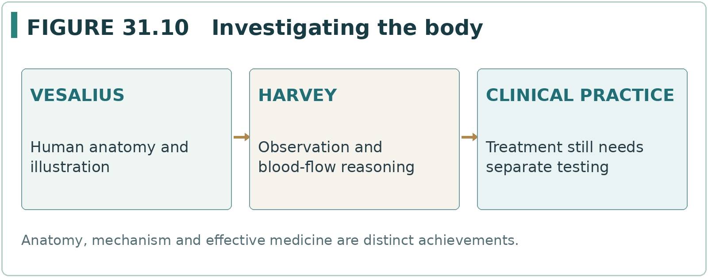

Андреас Vesalius на De humani corporis платка се появява през 1543, същата година, както и Коперник основна работа. Веселий подчертал прякото изследване на човешката анатомия и оспорил някои учения, свързани с Гален, чиито разкази отчасти отразявали дисекцията на животните. Анатомичното познание растело чрез дисекция, илюстрация, хирургия и спорове над религиозните и морални граници. Това беше практично и често етично трудно начинание, а не просто триумф на илюстрацията над книгите.

Уилям Харви де моту кордис (1628) твърди, че кръвта циркулира през тялото под изпомпващото действие на сърцето. Неговите разсъждения включвали анатомично наблюдение, експерименти с животни и оценка на притока на кръв. Количествената точка е от значение: обемът на кръвта, която ще трябва да бъде непрекъснато произведени при някои по-стари предположения изглежда невероятно голям. Като разгледал една система, Харви разработил по-убедителен разказ за кръвообращението.

Медицинският прогрес остава неравномерен. Лекарите продължават да разчитат на интервенции, чиято ефективност е несигурна и обясненията на заразната болест са непълни. Възходът на по-добра анатомия не трансформира общественото здраве за една нощ. Познаването на структурата, познаването на причината и способността за лечение на пациентите са свързани, но различни постижения.

<figure class="figure" id="figure-31-10">

<figcaption>Фигура 31.10. Анатомията, механизмът и ефективната медицина са различни постижения. <a class="figure-anchor" href="#figure-31-10" aria-label="Link to this figure">#</a></figcaption>
</figure>
