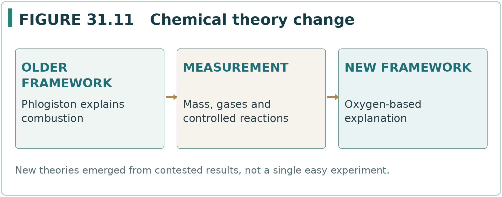

Химията от 17 - и 18 - и век се появила от традициите на медицината, минното дело, металургията, боядисването, дестилацията и алхимията. Следователите използваха пещи, реторти, стъклени съдове, баланси и практически познания, изградени в работилници. Robert Boyle's The Sceptical Chymist (1661) поставя под въпрос наследените дефиниции на елементи, въпреки че по-късно химията не просто ще приложи собствената си пълна система.

През осемнадесети век химиците обсъждали горенето и "Фологона," предложен принцип, свързан с горящите материали. Джоузеф Пристли и Карл Вилхелм Шееле, получени газове, които по-късно ще бъдат разбрани като кислород, докато Антоан-Ловерент Лавоазие и сътрудници разработиха различна обяснителна рамка въз основа на горенето, включващо кислород и прецизни измервания на масата. Лавоазие Елементарно Treatise на химия се появява през 1789 и помогна за реформиране химическа номенклатура.

Това не било просто сблъсък между ирационални вярващи и един единствен герой. По-старите теории могат да организират експерименти плодотворно, докато новите теории първоначално имаха свои собствени нерешени проблеми. Дори Лавоазие приемал хипотези, които по - късно били отхвърлени. Научното подобрение става по - лесно за разбиране, когато сравняваме предсказанията, експериментите, измервателните практики и способността на съперническите рамки да обясняват неприятни резултати.

<figure class="figure" id="figure-31-11">

<figcaption>Фигура 31.11. Нови теории се появяват от спорни резултати, нито един лесен експеримент. <a class="figure-anchor" href="#figure-31-11" aria-label="Link to this figure">#</a></figcaption>
</figure>
