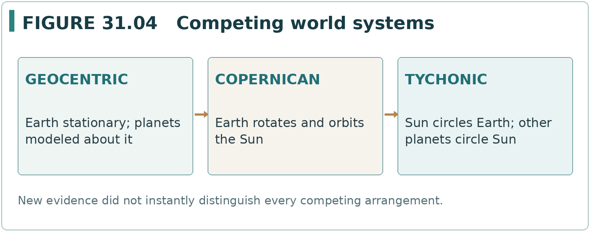

През 1543 Николай Коперник публикува De revolutionibus Orbium coelestium. Той предложи математическа договореност, в която Земята се върти ежедневно и с други планети пътува около Слънцето. Неговата система оспорва наследената геоцентрична рамка, но тя не доказва мигновено, че Земята се е преместила. Той запазва предположения за единни кръгови движение и използва математически устройства, за да се поберат наблюдавани планетарни позиции. Някои астрономи третирали неговите модели като изчислителни възможности, а не твърдения за физическа реалност.

Старата геоцентрична традиция не била просто глупава. Стационарната Земя съвпада с обикновения вид: ние се чувстваме твърда земя, а не движение. Без съвременната физика беше трудно да се обясни защо хората и предметите не отлетяха от въртящия се свят. Липсата на лесно наблюдаван годишен звезден паралакс също представлява сериозно историческо възражение срещу орбиталното движение на Земята. Точните звездни паралакс измервания дойдоха много по-късно.

Коперник промени структурата на проблема. Неговата поръчка на планетарни движения предлага завладяващ нов начин за интерпретиране на ретроградното движение и очевидни промени в планетарната яркост. Но астрономически теории трябва да бъдат съдени по това колко добре те обясняват и прогнозират наблюдения, а не по това как смели или привлекателни техните диаграми се появяват.

<figure class="figure" id="figure-31-4">

<figcaption>Фигура 31.4. Новите доказателства не разграничават веднага всяка конкурентна договореност. <a class="figure-anchor" href="#figure-31-4" aria-label="Link to this figure">#</a></figcaption>
</figure>
