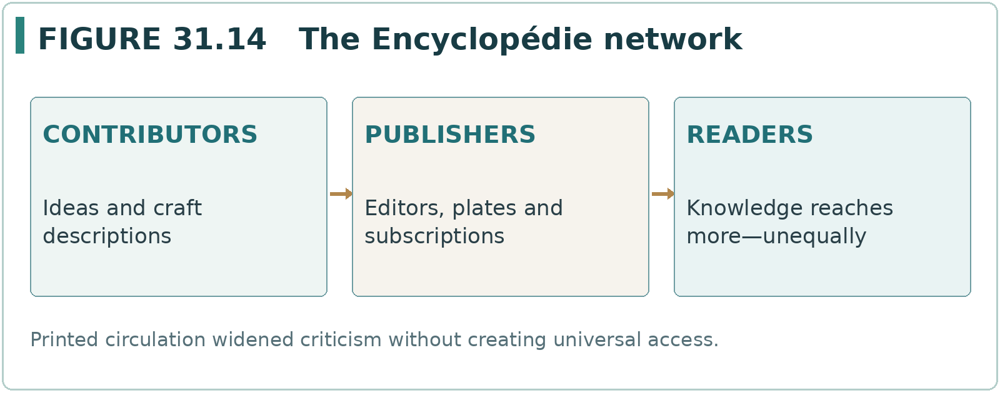

Денис Дидрот и Жан льо Ронд на Alembert помогнаха да доведе френски Encyclopédie, публикувани в големи вноски от 1751 в началото на 1770s. Тя се стреми да събере заедно изкуства, занаяти, философски дебат, както и технически описания. Чиниите на работилниците и машините са толкова важни, колкото и известните философски статии: те представят практическия труд като знания, достойни за системно описание.

Проектът бе изправен пред цензура и политическа враждебност. Той разчиташе на принтери, гравюри, редактори, сътрудници, абонати и сложни бизнес договорености. Съдържанието му не изразявало нито един последователен мироглед. Енциклопедията била място за срещи с различни аргументи, а не един манифест, договорен от всички замесени.

Паралелът с ранни научни списания е полезен. Организирането на познанието може да промени този, който се сблъска с него и който може да го предизвика. Но достъпът до референтната работа не е равен на универсалната грамотност или политическата свобода. Повечето европейски теми останаха далеч от привилегированите светове за четене, в които се разпространяваха такива издания.

<figure class="figure" id="figure-31-14">

<figcaption>Фигура 31.14. Отпечатаното кръвообращение разшири критиката без създаване на универсален достъп. <a class="figure-anchor" href="#figure-31-14" aria-label="Link to this figure">#</a></figcaption>
</figure>
