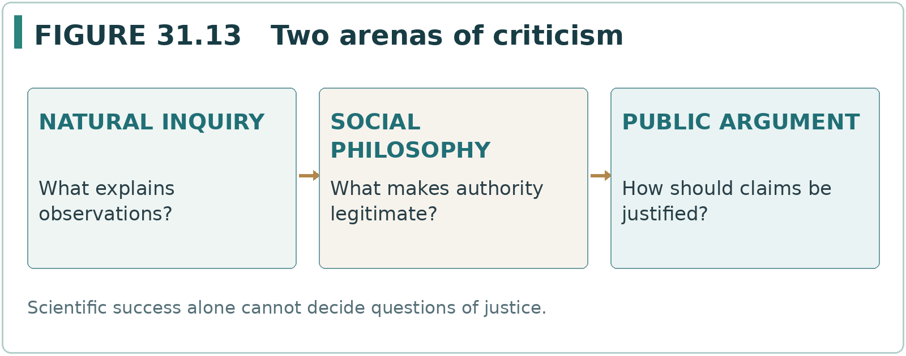

Просвещението не означавало просто, че хората открили факти и след това станали демократични. Философи, писатели, реформатори, духовници, администратори и критици развили различни видения за човешко подобрение през дългия осемнадесети век. Някои се надяваха на конституционно правителство, други предпочитаха добре информиран и реформиращ монарх. Някои от тях защитавали религиозната търпимост, а други по - агресивно атакували организираната религия. Мнозина се възхищаваха на търговията и образованието, докато не бяха съгласни с неравенството и империята.

Въпреки това няколко теми свързаха движенията: увереността, че институциите могат да бъдат разследвани, аргументите относно природните права или хуманното отношение към човека, нарастващото четене на обществеността и твърдението, че обичайният орган трябва да се оправдае. Мислителите на Просвещението често гледали на откритията във физиката като на примери за човешки разсъждения, но политическите общества не могат да бъдат изучавани точно като падащи камъни. Моралните ценности и конкурентните интереси влизат във всяка сметка на доброто правителство.

Следователно централното разграничение на главата е между способността да се обяснят природните явления и правото да се вземат решения за политически договорености. Научните доказателства могат да изяснят вероятните резултати от дадена политика; тя не само решава кое е справедливо. Не бива мълчаливо да превръщаме научната власт в морална власт.

<figure class="figure" id="figure-31-13">

<figcaption>Фигура 31.13. Само научният успех не може да решава въпроси, свързани с правосъдието. <a class="figure-anchor" href="#figure-31-13" aria-label="Link to this figure">#</a></figcaption>
</figure>
