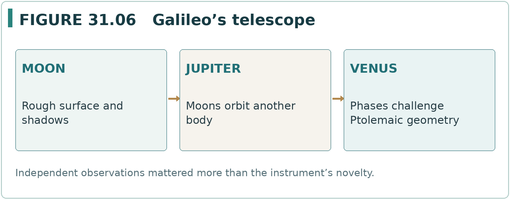

През 1609.10 Галилео Галилей подобрява наличния телескоп и го насочва към небесата. Той наблюдавал неравна лунна повърхност, множество слаби звезди, четири големи спътника на Юпитер, а по-късно и фазите на Венера. Тези наблюдения оспориха широко приетите очаквания. Луната не беше безупречно гладка сфера. Не всеки небесен обект се върти около Земята. Венера показа модел на фази, които не съвпадат със стандартната Птолемейска аранжировка.

Но предпазливостта е от значение. Фазите на Венера са съвместими с повече от една слънчева аранжировка, включително Тихоничната система със стационарна Земя. Телескопът на Галилей не е разрешил целия космологичен дебат. Оптично качество, интерпретация на това, което един непознат инструмент показва, и достъп до повтарящи се наблюдения всички са от значение. Други астрономи трябваше да се научат да вярват на устройството и да възпроизвеждат наблюденията.

"Галилео" също разследва падащи органи, наклонени равнини, движение, и математически регулации, допринасящи за нови сметки на механика. Неговата работа не е спретнато изолирана серия от експерименти точно съвпадение на всеки по-късен предсказание. Известната история за падането на неравни тежести от кулата на Пиза не е сигурен очевидец на решителен експеримент. Това, което има значение е дисциплиниран математически анализ на движението и неговата евентуална роля в по-късната физика.

<figure class="figure" id="figure-31-6">

<figcaption>Фигура 31.6. Независимите наблюдения имаха по-голямо значение от новостите на инструмента. <a class="figure-anchor" href="#figure-31-6" aria-label="Link to this figure">#</a></figcaption>
</figure>
