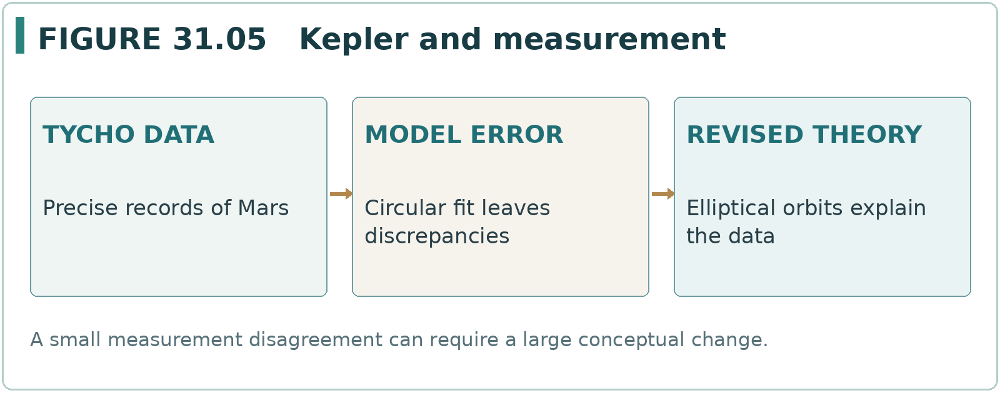

Йоханес Кеплер заключил, че планетите се движат по елипсите със Слънцето с един фокус, а не върху перфектните кръгове. Неговите три закона, формулирани в рамките на произведения, публикувани между 1609 и 1619, описани elliptical орбити, метене на равни области в равни времена, както и математическа връзка между орбитални периоди и разстояния. В опростена форма, в третия закон се казва, че квадратът на орбиталния период на планетата се увеличава пропорционално на куба на полу-голямата ос на орбитата си около Слънцето.

Постижението на Кеплер не идвало от простото рисуване на по - добра картина. Той се бореше с несъответствието между по-ранните модели и измерванията на Тихо, особено известната разногласие от приблизително осем арку минути за Марс. Вместо да обяви несъответствието за незначително, той го третира като доказателство, че моделът трябва да се промени. По-добри измервания могат да изискват изоставяне на красиви предположения.

Първоначално законите били описания, а не по-късно обяснението на Нютон за гравитационните причини за движенията. Кеплер също имал спекулативни и религиозни вярвания, които съвременните учени нямали да приемат. Това не трябва да ни обърква. Хората могат да произвеждат трайни знания, като същевременно запазват други погрешни или непреодолими идеи. Съдете всяко обяснение по работата, която извършва.

<figure class="figure" id="figure-31-5">

<figcaption>Фигура 31.5. Едно малко мерило може да изисква голяма концептуална промяна. <a class="figure-anchor" href="#figure-31-5" aria-label="Link to this figure">#</a></figcaption>
</figure>
