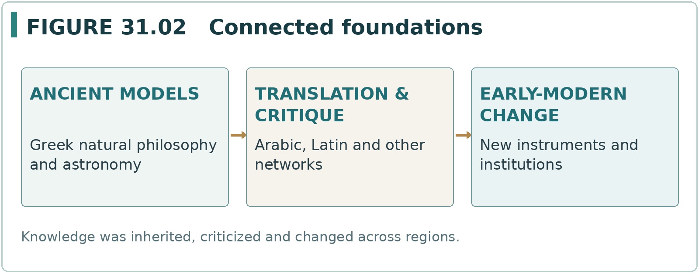

Европейските университети наследили интелектуални традиции, съчетаващи Аристотел, Птоломей, Хипократ, Гален, християнската теология и средновековния коментар. Аристотел на произведения не са били четени като една проста, непроменяща се доктрина; учителите спорен тълкуване и разработени сложни въпроси за движение, каузи, и доказателства. Математически астрономия често се използва Ptolemaic модели: deferents, epicycles, и други геометрични устройства за прогнозиране на позициите на небесните тела. Сложният модел може да бъде резултатен при предсказанията, дори когато по - широкият разказ за вселената се окаже непълен.

Голяма част от това обучение е преминал през арабски стипендия, превод, и първоначалното разследване. Учените, включително Ibn ал-Haytham са развили влиятелна работа по оптика, докато астрономите в ислямския свят критикувани и модифицирани наследени планетарни модели. Индийските математически традиции допринесли важни идеи за изчисляване; Китайските астрономи поддържали обширни записи на небесните явления и календари. Имаше и местни европейски традиции за навигация, металургия, архитектура, медицина и занаятчийски експерименти.

Това не означава, че всяка цивилизация следва една обща научна програма. Техните институции, въпроси, инструменти и форми на власт варираха. Централната историческа точка е, че по-късно европейските следователи работиха в рамките на дълго и свързано наследство. Иновациите често означаваха пренареждане или предизвикателство на знанията, които вече циркулират, а не замяна на интелектуална празнота.

<figure class="figure" id="figure-31-2">

<figcaption>Фигура 31.2. Знанието било наследено, критикувано и променено в различните региони. <a class="figure-anchor" href="#figure-31-2" aria-label="Link to this figure">#</a></figcaption>
</figure>
