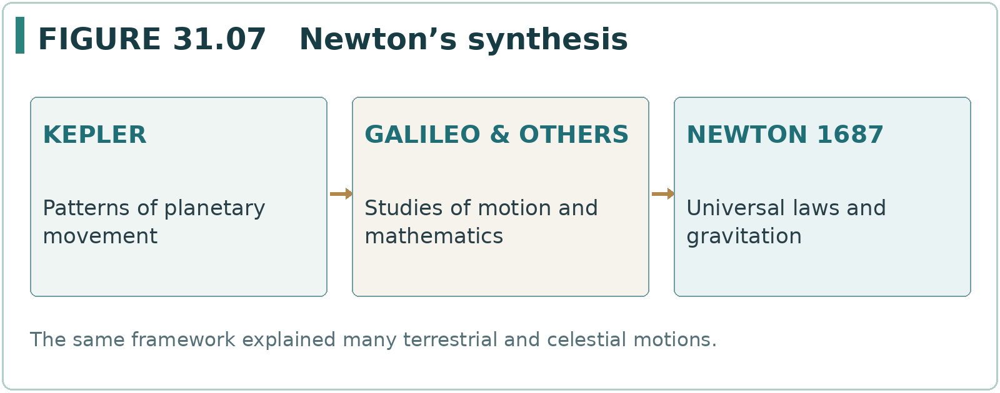

Исак Нютон на Principia (1687) взети заедно сметка на движение и универсален закон на гравитацията. Неговите закони описват взаимоотношенията между сила, маса и промени в движението; универсална гравитация изразява привличане между масите, които варират обратно с квадрата на тяхното разделяне. При опростена идеализация, удвояването на разстоянието между две точки маси намалява гравитационната сила между тях до една четвърт.

Това е от значение, защото една и съща математическа рамка може да обясни земното падащо движение и орбитите на небесните тела. Кеплер е описано планетарни модели; Нютон показа как един обратен квадрат гравитационна сила може да произвежда такива модели при подходящи условия. Постижението е синтез на нови методи, предишни разследвания, както и трудно математика, а не самотен проблясък на вдъхновение.

Рамката на Нютон не била окончателна теория за всичко. По-късно изследователите рафинирани измервания и открити явления, че не може да обясни напълно; Общата относителност на Айнщайн в крайна сметка ревизиран разказ за гравитация в по-дълбоки мащаби. Нищо от това не означава, че нютоновата физика е безполезна. Моделът може да бъде изключително точен в рамките на определен диапазон и все още да бъде подобрен. Това е една от най-дълбоките силни страни на науката.

<figure class="figure" id="figure-31-7">

<figcaption>Фигура 31.7. Същата рамка обяснява много земни и небесни движения. <a class="figure-anchor" href="#figure-31-7" aria-label="Link to this figure">#</a></figcaption>
</figure>
