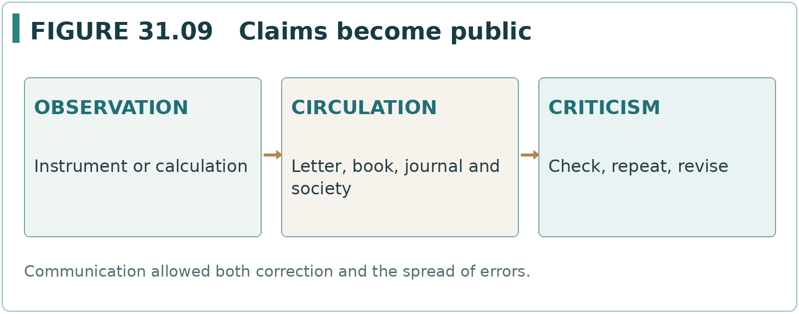

Ранномодерните учени разменят писма, книги, инструменти и наблюдения през границите. Мрежите, описани по-късно като "репутация на писма," свързват хора, които са политически, лингвистично и религиозно разделени. Членството беше неравномерно и елитно. Кореспонденцията може да бъде забавена от война, цензура, разстояние или бедност. Но това позволи астрономическо наблюдение в един град да бъде обсъдено другаде и спорен експеримент да се повтори.

Институциите дават на тези мрежи по-трайни форми. Кралското дружество на Лондон започва през 1660 г. и получи кралската си харта през 1662 година. Париж Académie Royale на науките е създадена през 1666. Философските сделки започнаха да се публикуват през 1665 г. при Хенри Олденбург; това беше ранен модел за научна комуникация, въпреки че съвременният анонимен партньорски преглед не изглежда напълно формиран в този момент.

Тези институции изградиха колективна памет и култура на публични претенции, но също така отразиха социалната сила. Богатството, покровителството, езикът, полът и религиозната позиция оказвали влияние върху участието. Печатната статия стана доказателство, че е била разпращана претенция; това не означава автоматично, че твърдението е било проверено самостоятелно. Критичният идеал беше дискусията и корекцията с течение на времето.

<figure class="figure" id="figure-31-9">

<figcaption>Фигура 31.9. Комуникацията позволяваше както корекция, така и разпространение на грешки. <a class="figure-anchor" href="#figure-31-9" aria-label="Link to this figure">#</a></figcaption>
</figure>
