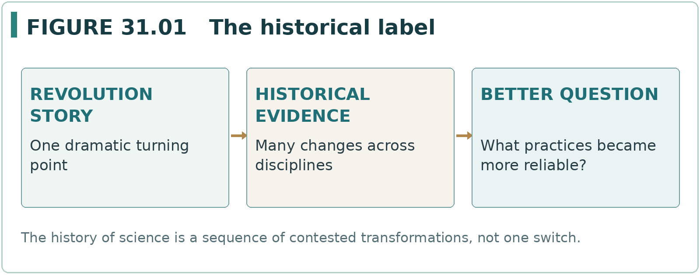

Революцията предполага бързо обръщане. И все пак трансформациите, описани в тази глава, се състояха през поколенията и се различаваха по различни дисциплини. Астрономията се променя в една последователност; анатомията и химията следват други пътища. Много раномодерни мислители все още приемат астрологията, алхимията, библейската хронология или идеите по - късно изоставени. Нютон учи теология и алхимия, както и математическа физика. Хората, които наричаме "учени," обикновено се наричат естествени философи, математици, лекари или експериментални практикуващи.

Следователно историците спорят за полезността и границите на фразата Scientific Revolution. Тя подчертава забележителни трансформации, по-специално математическа физика и експериментални институции, но може погрешно да означава един неизбежен път от средновековна грешка към съвременната истина. Тя може също така да кредит само няколко европейски гении, докато пренебрегва по-ранна астрономия, математика, оптика и технически традиции от цяла Евразия и Африка.

Нашият подход е да попитаме за променящите се практики, вместо да твърдим внезапна победа на истината. Какви наблюдения могат да направят хората? Как са се карали? Кой плати за инструменти и книги? Възможно ли е твърдението да бъде проверено самостоятелно? Защо някои обяснения убедили повече изследователи от други? Същият метод трябва да управлява и нашето отношение към Просвещението: стремежът му да критикува наследената власт беше реален, но твърденията му за универсалност се нуждаят от тестване срещу този, който е бил изключен.

<figure class="figure" id="figure-31-1">

<figcaption>Фигура 31.1. Историята на науката е поредица от спорни трансформации, а не един ключ. <a class="figure-anchor" href="#figure-31-1" aria-label="Link to this figure">#</a></figcaption>
</figure>
