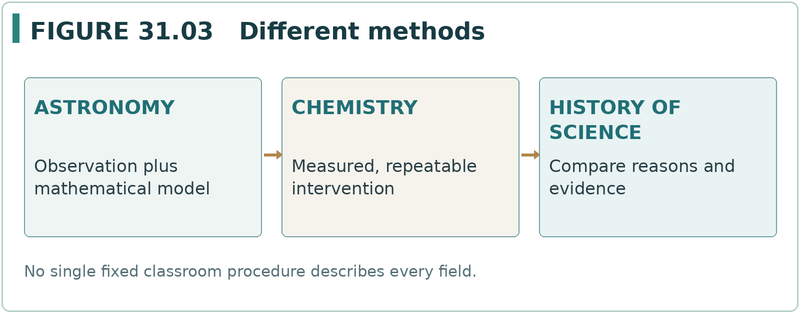

Съвременните учебници могат да покажат права линия: наблюдение, хипотеза, експеримент, заключение. Това може да бъде полезна образователна рамка, но тя не описва всяко важно откритие. Астроном не може да премести Юпитер в друга част на небето, за да проведе контролиран експеримент. Лекарят може да сравнява пациентите и дисекциите. Химикът може да тежи вещества преди и след реакцията. Един математик може да докаже предложение без лабораторно оборудване. Един историк на науката трябва да попита какъв въпрос е бил отговорен.

Няколко промени станаха влиятелни: системни измервания, математически модели, целеви експерименти, и публично сравнение на резултатите. Никой не е гарантирал успех. Лошите инструменти могат да произведат прецизни числа; моделите могат да се поберат известни наблюдения, но не и другаде; експериментаторите биха могли да интерпретират същия резултат различно. Новата практика на критика беше също толкова важна, колкото и един нов инструмент. Една претенция трябваше да оцелее след възражения относно процедурата, предположенията и конкурентните обяснения.

Важно разграничение от глава 1 се връща тук. Наблюдението не говори само по себе си. Доказателствата имат значение в един въпрос и модел. Ранните изследователи не просто замениха авторитета със сетивата; те изградиха нови стандарти за спор относно това какво показват сетивата и инструментите.

<figure class="figure" id="figure-31-3">

<figcaption>Фигура 31.3. Нито една фиксирана процедура в класната стая не описва всяко поле. <a class="figure-anchor" href="#figure-31-3" aria-label="Link to this figure">#</a></figcaption>
</figure>
