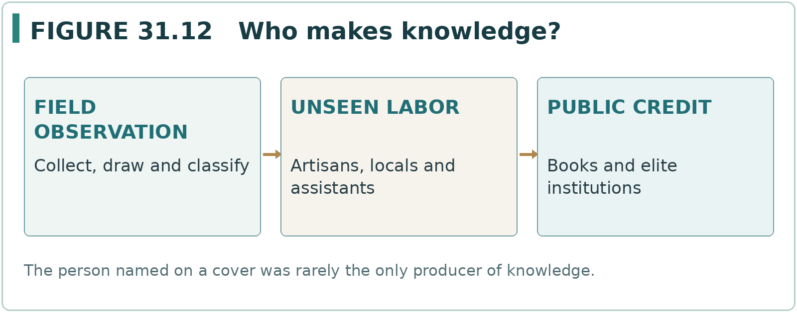

Възможностите на жените да влизат в университети, учени общества и офиси с висок статут бяха силно ограничени, но жените участваха в научна и философска работа чрез кореспонденция, патронаж, преподаване, рисуване, използване на инструменти, домакински лаборатории и публикуване. Маргарет Кавендиш пише произведения на естествената философия и критикува аспекти на експерименталната култура. Мария Сибила Мериан изучава метаморфозата на насекомите и работи с подробна ботаническа и ентомологична илюстрация, включително изследване в Суринам.

Émilie дю Châtelet допринесли за тълкуването на Newtonian физика и пише за физическа теория и научно обяснение. Caroline Herschel астрономически работата стана важно в края на осемнадесети век. Тези цифри представляват различни контексти и видове постижения; те не трябва да се свеждат до декоративен списък на изключения от мъжката интелектуална история.

Техният опит също показва, че границите на уважаваното познание са били социални избори. Някой, който може да наблюдава или изчислява все още може да бъде лишен от институционален статут или достъп до библиотека. Една правдоподобна история трябва да проследява самата работа, а също и бариерите, които оформят работата, която е запазена, отпечатана и запомняща се.

<figure class="figure" id="figure-31-12">

<figcaption>Фигура 31.12. Лицето, което е на корицата, рядко е единственият производител на знания. <a class="figure-anchor" href="#figure-31-12" aria-label="Link to this figure">#</a></figcaption>
</figure>
