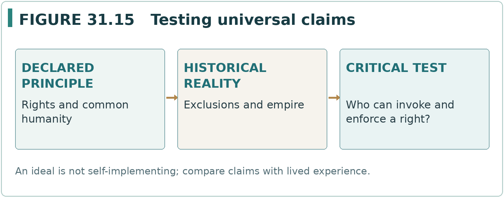

Езикът на универсалната причина и природните права съществуваха съвместно с изключения, основани на пол, религия, правен статут и идеи за раса. Европейските държави се възползваха от колониалната търговия и робството в Атлантическия океан, докато някои интелектуалци защитаваха свободата на гражданите. Много писатели на Просвещението критикували робството; други рационализирали господството или не прилагали принципите си последователно. Противоречието е част от историята, а не неприятна бележка под линия.

Мислители, включително Mary Astell, по-рано са спорили за образованието на жените; по-късно Mary Wollstonecraft поиска радикално преосмисляне на статуса на жените, най-известни в A Vaidation of the Rights of Woman (1792). Олимп де Гуж изрази искания за политическо равенство на жените по време на Френската революция. Африкански и афро-осведомени писатели и активисти оспорват робството и расовата йерархия в собствените си гласове. Олауда Equiano на 1789 autobiography стана влиятелен в аболиционистки дебат, въпреки че историците продължават да разследват аспекти на неговата биография.

Критичният интелектуален ход е да се запитаме дали установената универсалност на даден принцип е съчетана с практиката. Този въпрос не е отхвърляне на равенството; той е тест за това дали едно общество желае да приложи логиката на собствените си претенции.

<figure class="figure" id="figure-31-15">

<figcaption>Фигура 31.15. Идеалът не е самоусъвършенстване; сравни твърденията с живия опит. <a class="figure-anchor" href="#figure-31-15" aria-label="Link to this figure">#</a></figcaption>
</figure>
