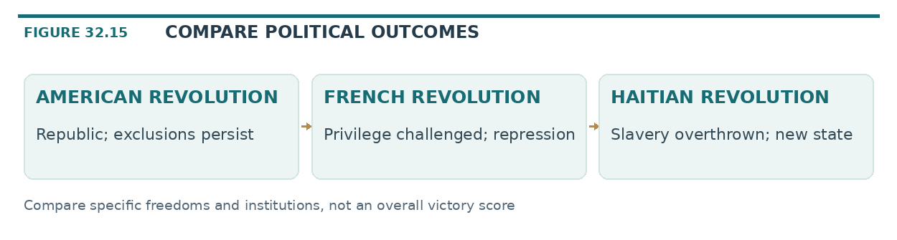

Да разгледаме трима измислени личности, построени за преподаване, а не въз основа на индивидуален исторически живот. Един занаятчия в Бостън през 1787 г. може да присъства на политически срещи, но може да бъде изправен пред квалификация собственост или други местни ограничения за гласуване. Парижката жена на пазара през 1791 г. може да се мобилизира в демонстрации и да публикува аргументи, но все още не притежава национални избирателни права при същите условия като този, който отговаря на условията за участие в изборите. Работник в Сен-Доминг след премахването му вече не е законно поробен, а може да се изправи пред принудителни земеделски разпоредби и ограничена способност за избор на работодател или пребиваване.

Кой човек е "свободен"? Въпросът е твърде широк. Трябва да разграничим свободата от робството, свободата на словото, политическото участие, свободата на движение, сигурността на собствеността и равенството пред съдилищата. Отговорите могат да се различават по измерение. Това е мощна причина да се изучава гражданството като пакет от специфични способности и защити, а не прост етикет, даден на обществото.

<figure class="figure" id="figure-32-15">

<figcaption>Фигура 32.15. Сравнете конкретни свободи и институции, а не общ резултат победа. <a class="figure-anchor" href="#figure-32-15" aria-label="Link to this figure">#</a></figcaption>
</figure>

Сега си представете оценка на четвърти човек: местен политически лидер, преговарящ с ранните Съединени щати. Републиката може да третира своята нация като страна, която сключва договори в една ситуация и да се стреми да ограничи територията си в друга. Гражданството в държава и политическа автономия на отделни хора не е един и същ въпрос. Определенията, които работят за заселник на собственост, може да не обяснят местния суверенитет. Сравнението е най - ценно, когато разкрива такива граници, вместо да ги прикрива.
