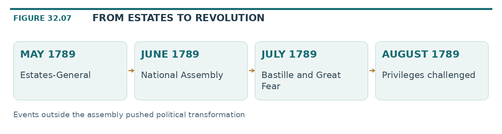

На 14 юли 1789 г. тълпи в Париж щурмуват Бастилията - крепостен затвор, свързан с царска власт. Въпреки че държал много малко затворници, символичното му значение било огромно и веднага от значение било завземането на оръжие. В провинцията, Големият страх се разпространява сред слухове, паника, атаки срещу собственост и сейньорски записи, и съпротива срещу феодални задължения. Революцията се превръщаше в събитие в селата, както и в състезание между длъжностни лица.

През нощта на 4 август Народното събрание започна разглобяването на основни елементи от стария режим на привилегия и сейньорски статут. Правното уреждане не беше незабавно или просто; някои задължения първоначално изискваха изкупление, а последващото законодателство промени условията. Въпреки това новият политически език оспорва принципа, че благородното раждане може да оправдае отделни правни права. Властта била реконструирана, а не просто прехвърлена от цар в парламента.

<figure class="figure" id="figure-32-7">

<figcaption>Фигура 32.7. Събитията извън парламента предизвикаха политическа трансформация. <a class="figure-anchor" href="#figure-32-7" aria-label="Link to this figure">#</a></figcaption>
</figure>

Историците отличават Големия страх като група от регионални паникьосвания и действия, а не централно насочена национална конспирация. Поучително е, че самият страх може да доведе до последствия дори когато слухът се окаже фалшив. Социалните групи действаха според вярванията си относно движенията на войските, аристократичните сюжети или доставките на храна; тези действия помогнаха да се определи какво следва да направи Народното събрание.
