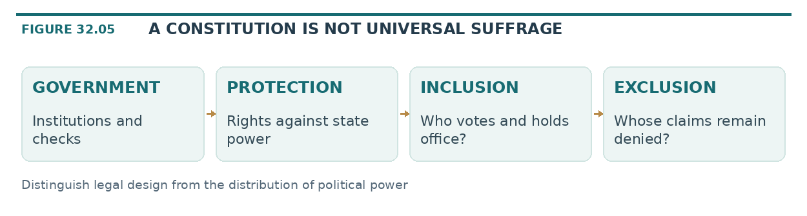

Първата национална рамка, членовете на Конфедерацията, влезе в сила през 1781 г. и остави централното правителство с ограничен капацитет за повишаване на приходите или координиране на икономическата политика. Политически лидери, които се страхуваха от тази слабост, свикана във Филаделфия през 1787 г. и изготвиха нова Конституция. Той създава федерални институции, разделени правомощия и установява механизми за представителство и изменение. Поддръжниците твърдят, че това ще осигури трайно правителство; противниците се опасявали, че един далечен централен орган може да застраши свободата. Ратификационните дебати бяха сериозни политически конкурси, а не формалност.

Последващите договорености въплътиха компромиса и йерархията. Конституцията осигури представителство в Конгреса и непряка президентска изборна система, но не създаде универсална демокрация. Неговата три пета формула брои поробените хора за определени изчисления на представителство и данъчно облагане, като същевременно им отказва политически права; нейните рамкири правят други компромиси, защитавайки робството. Първите десет изменения, ратифицирани през 1791 г. и известни като Законопроекта за правата, помогнаха за справяне със страховете за федералната власт, но те не изтриха расовите и полови изключвания.

<figure class="figure" id="figure-32-5">

<figcaption>Фигура 32.5. Отличен правен дизайн от разпределението на политическата власт. <a class="figure-anchor" href="#figure-32-5" aria-label="Link to this figure">#</a></figcaption>
</figure>

Конституцията може да бъде революционна, без да бъде егалитарна във всяко измерение. Тя може да замени монархията с република, като същевременно запазва влиянието, основано на богатството, принудителния труд или териториалното разпадане. Струва си да се запомни разликата между дизайна на правителството и неговата операция. С течение на времето политическите борби, съдебните решения, социалните движения и други изменения ще предефинират американското гражданство. Тези резултати не са били вече гарантирани през 1787 г.
