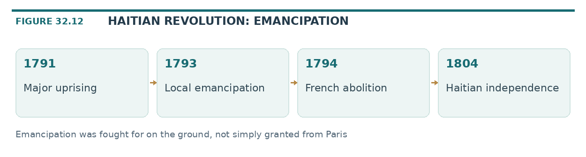

През 1793 г. френските комисари в Сен Доминик обявяват еманципацията на фона на военната криза, бунта и конфликта между колониалните групи. През февруари 1794 г. Националната конвенция в Париж премахна робството във френските колонии. Взаимоотношенията между събитията на място и решенията в метропола бяха фундаментални: указът за метрополитан одобри трансформация, за която вече са се борили поробените хора. Тя не трябва да се описва като чисто щедър подарък от революционна Франция.

Еманципацията не определи как ще функционира експортната икономика. Земята на плантацията, работната заплата, селскостопанската дисциплина, военната власт и правата на собственост останаха спорни. Бившите поробени работници често искаха по - голям контрол върху своето време, семейства и земя, докато революционните командири и длъжностни лица се опасяваха от колапс на производството и военните доставки. Законното унищожаване на робството отвори нови конфликти относно същността на свободата.

<figure class="figure" id="figure-32-12">

<figcaption>Фигура 32.12. Еманципацията се е водила на място, а не просто от Париж. <a class="figure-anchor" href="#figure-32-12" aria-label="Link to this figure">#</a></figcaption>
</figure>

Сравнителна точка сега става видима. В Съединените щати революционните лидери могат да обявят независимост, запазвайки робството. Във Франция революция провъзгласява права и за известно време премахва робството в колониалната империя. В Сен Доминг свободата била създадена и защитавана от организирана борба в плантационна колония. Тези различия предупреждават да не се представят Атлантическите революции като един униформен марш към свободата.
