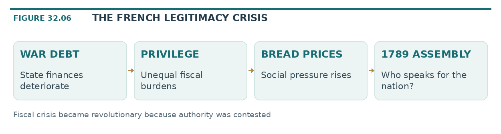

Във Франция монархията председателствала едно общество, обикновено описано чрез три имения: духовенство, благородство и третото имение, което обхващало всички останали. Това официално разделение не улови всяко неравенство. Някои обикновени хора били богати; някои благородници имали скромни ресурси; местните привилегии и регионалните съдилища усложнявали царската реформа. Въпреки това освобождаването и неравните фискални задължения направиха системата спорна, особено когато държавните финанси се влошиха след скъпи войни и заеми.

Фискалната криза във Франция имаше няколко причини, включително обслужване на дълга, неефективна и неоправдана структура на приходите, политическа съпротива срещу реформите и разходите за подпомагане на американския бунт. Бедната реколта през 1788 г. и високата цена на хляба засилили стреса. Монархията не е изправена пред прост технически недостиг на пари; тя е изправена пред политически проблем при получаване на съгласие за това кой трябва да плати и коя институция има властта да реши. Фискалната администрация се превърна в въпрос на суверенитет.

<figure class="figure" id="figure-32-6">

<figcaption>Фигура 32.6. Фискалната криза стана революционна, защото авторитетът беше оспорен. <a class="figure-anchor" href="#figure-32-6" aria-label="Link to this figure">#</a></figcaption>
</figure>

Луи XVI призова генералните имоти за 1789 г., първото такова национално събрание от 1614 г. насам. Подготовките включваха кахиери де доленс, списъци с оплаквания, които записаха широк спектър от очаквания. Някои писатели искали реформи, докато запазвали монархията; други критикували по - дълбоко привилегиите. Кризата направи политическото участие видимо в мащаб, който обикновеното кралско управление не очакваше.
