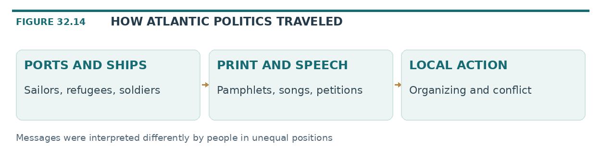

Идеите се преместват чрез писма, моряци, военни доброволци, дипломатически мисии, книги, пристанищни вестници, изгнаници и завръщащи се войници. Някои твърдения бяха преведени или адаптирани за нова публика. Други са били изкривени от страх или избирателно докладване. Един вестник в пристанище, което държи роби, може да описва събитията в Хаити като опасни разстройства, докато един поробен читател или слушател би могъл да ги разбере като доказателство, че робството може да бъде предизвикано. Същото събитие придоби коренно различни значения в зависимост от това кой контролираше неговото предсказание.

Комуникациите бяха по-бавни, по-неравни и по-крехки от съвременните медийни мрежи. Новините можеха да пристигнат, след като обстоятелствата се бяха променили. Политически брошури, разпространявани в рамките на грамотността и ограниченията за разходите, докато речи, песни, религиозни събирания и устни мрежи достигаха до публиката, която печатните текстове не правеха. Твърди, че една известна книга, защото "революция обикновено преувеличава силата на отделните автори и пренебрегва организационната работа, която превръща идеите в действие.

<figure class="figure" id="figure-32-14">

<figcaption>Фигура 32.14. Съобщенията бяха интерпретирани по различен начин от хората в неравнопоставени позиции. <a class="figure-anchor" href="#figure-32-14" aria-label="Link to this figure">#</a></figcaption>
</figure>

Полезно е да се мисли за верига: недоволство → организирани мрежи → обществени аргументи → конфронтация → променящите се институции. Но веригата се върти. Конфронтацията създава нови оплаквания; законите създават нови категории участници; съюзите за военни промени; чуждите сили се намесват. Процесът не е предварително определена последователност. Ето защо революциите са по-добре обяснени чрез взаимодействащи условия, отколкото чрез едно героично решение.
