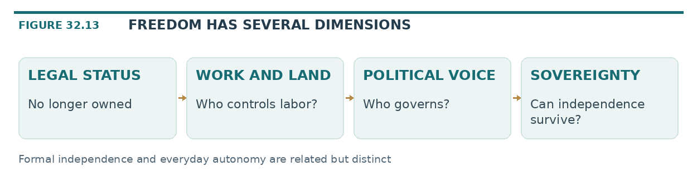

Наполеон Бонапарт изпраща голяма експедиция до Сен Доминг през 1802 г., за да подсигури отново метрополитическия контрол. През същия период правителството му възстановило робството във френските колонии, където то не било ефективно премахнато или където френският контрол бил възстановен. Затова страховете, че робството може да се завърне в Сен Доминг, са били основани на съвременната политика и събития, а не само на слухове. Лувъртура е заловен и транспортиран до Франция, където той умира през 1803.

Конфликтът продължи при други командири, включително Жан-Жак Десалин и Анри Кристоф. Френските сили страдат от жестока съпротива, стратегически трудности и опустошителни болести. Тяхното поражение в битката при Вертиер през ноември 1803 г. е последвано от декларация за независимост на 1 януари 1804 г. Новата държава прие името Хаити, припомняйки местната история, докато се разделяше с френския колониален режим.

<figure class="figure" id="figure-32-13">

<figcaption>Фигура 32.13. Формалната независимост и ежедневната автономия са свързани, но различни. <a class="figure-anchor" href="#figure-32-13" aria-label="Link to this figure">#</a></figcaption>
</figure>

Независимостта не сложи край на принуда или политическо насилие. Войските на Десалин извършвали убийства на много останали френски бели през 1804 г.; новата държава също се сблъскала с унищожение, дипломатическа изолация, вътрешни съперници и конфликти по отношение на труда и земята. Революционното постижение на Хаити, успешното създаване на независима държава чрез бунт срещу робството, трябва да се преподава заедно с тези трудности. Празнуването на еманципация не изисква изтриване на зверствата и признаването на жестокостите не намалява еманципацията.
