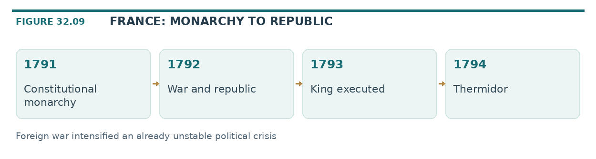

Националната конвенция обявява република през септември 1792 г. Луи XVI е екзекутиран през януари 1793 г. след политически процес и законодателен вот. Тези събития шокираха европейските монархии и превърнаха конфликта от борба над конституционната монархия в конкурс, включващ династична легитимност и революционен суверенитет. Революционната Франция се сблъскала с чужди армии, вътрешни въстания, финансови трудности и дълбоки разногласия относно правилното темпо и форма на промяна.

Фактическите етикети като Girondins и Montagnards могат да бъдат полезни, но те описват променящи се коалиции, а не модерни дисциплинирани политически партии. Градски активисти, известни като Санс-кулоти, настояваха за искания по отношение на хляб, цени и политическо участие. Селските общности се различавали в отговора си на запитването, религиозните реформи, данъчното облагане и революционната власт. Войната във Венде стана особено разрушителна, включваща бунтове, брутално потисничество и насилие срещу цивилни.

<figure class="figure" id="figure-32-9">

<figcaption>Фигура 32.9. Чуждестранната война засили вече нестабилната политическа криза. <a class="figure-anchor" href="#figure-32-9" aria-label="Link to this figure">#</a></figcaption>
</figure>

Важно е да не се свеждат участниците в "Народа" от едната страна и "врагове на свобода" от другата. Един парижански работник, провинциален свещеник, селско домакинство и революционерски войник може да имат различни възгледи относно религията, цените на храните, войната и демокрацията. Политическата легитимност при криза зависи от това чии гласови органи признават и какви форми на несъгласие позволяват.
